# Zed editor

The optional [`editor`](https://github.com/moriyoshi/gpui-go/blob/main/editor/README.md) package opens persistent multiline editors backed by Zed's own editor, with independent buffers and undo history. Run the example with `make editor`.

::: danger License notice
The native editor links GPL-3.0-or-later Zed code. An application distributed with it linked in must meet the GPL's requirements for the combined work, including providing corresponding source. Ordinary gpui-go builds do not link it.
:::

Every screenshot on this page is the real editor, opened by the code shown beside it.

## A first editor

Call `editor.Run` once from `main`, and open editors from its callback:

```go
err := editor.Run(context.Background(), func(ctx context.Context, app *editor.Client) error {
	field, err := OpenCode(ctx, app)
	if err != nil {
		return err
	}
	for {
		event, err := app.NextEvent(ctx)
		if err != nil {
			return err
		}
		if event.Kind == editor.EditorClosed && event.EditorID == field.ID() {
			return nil
		}
	}
})
```

```go
func OpenCode(ctx context.Context, app *editor.Client) (*editor.Editor, error) {
	return app.Open(ctx, editor.Options{
		Title:  "main.go",
		Text:   goSource,
		Width:  620,
		Height: 300,
	})
}
```

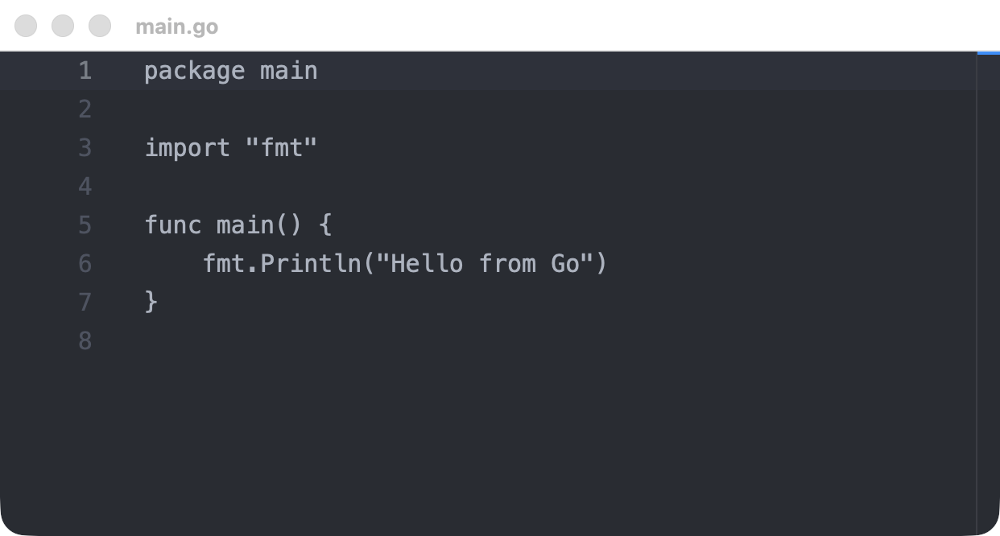{width=621}

This is plain-text editing, so the code above has no syntax colors. To add them, see [Syntax highlighting](#syntax-highlighting).

`editor.Run` owns the process-wide runtime, so it cannot run alongside `host.Run`. It shows one editor per native window. To put an editor inside your own layout, see [Placing an editor inside a view](#placing-an-editor-inside-a-view).

## Options

| `editor.Options` field | Description |
| --- | --- |
| `Title` | Window title, at most 1024 bytes. Defaults to `Editor` |
| `Text` | Initial text. It creates no undo entry |
| `Width`, `Height` | Window size from 100 to 16384. Zero selects 1000 by 700 |
| `ReadOnly` | Blocks editing by the user |
| `HideGutter` | Hides the line numbers |
| `DisableSoftWrap` | Keeps long lines on one row. Soft wrap is on by default |
| `WidthTable` | How `Position` counts East Asian Ambiguous characters. See [Moving the cursor](#moving-the-cursor) |

Hide the gutter for prose:

```go
func OpenNotes(ctx context.Context, app *editor.Client) (*editor.Editor, error) {
	return app.Open(ctx, editor.Options{
		Title:      "Notes",
		Text:       prose,
		Width:      560,
		Height:     280,
		HideGutter: true,
	})
}
```

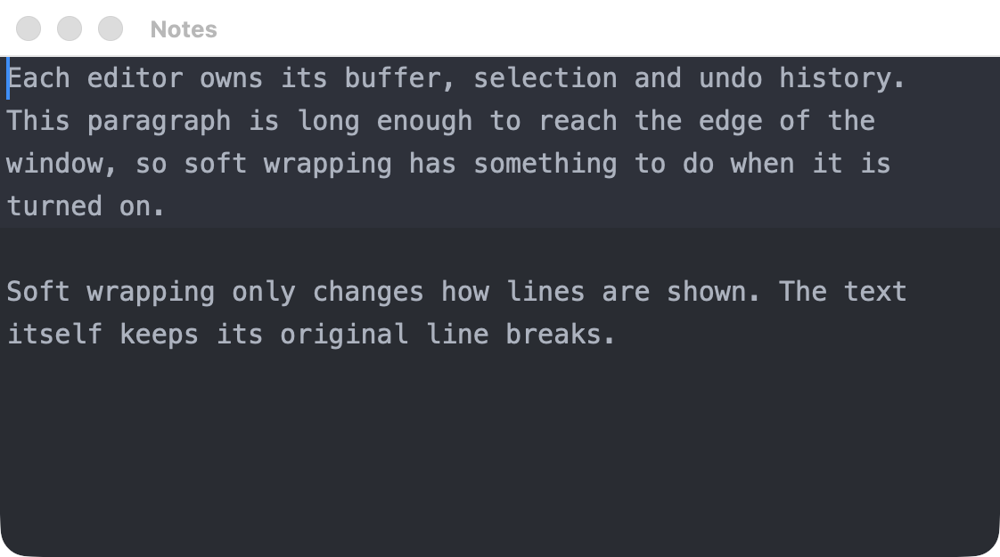{width=561}

Turn off soft wrap for content with meaningful line lengths:

```go
func OpenLog(ctx context.Context, app *editor.Client) (*editor.Editor, error) {
	return app.Open(ctx, editor.Options{
		Title:           "Build log",
		Text:            prose,
		Width:           560,
		Height:          280,
		ReadOnly:        true,
		DisableSoftWrap: true,
	})
}
```

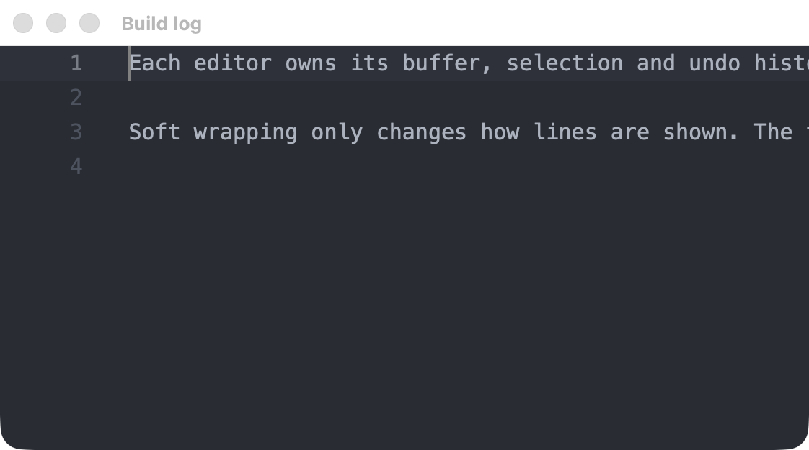{width=561}

Unicode, including combining sequences and emoji, works as it does in Zed:

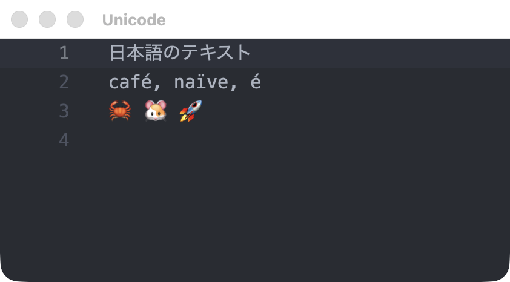{width=421}

## Editing from Go

| `Editor` method | Description |
| --- | --- |
| `State(ctx)` | Returns the current text, revision, read-only flag and selection |
| `SetText(ctx, text)` | Replaces the whole text. Also allowed on a read-only editor |
| `InsertText(ctx, text)` | Replaces the current selections, as one undo step |
| `SetSelection(ctx, start, end)` | Moves the cursor or selects a range, and scrolls it into view |
| `Undo(ctx)`, `Redo(ctx)` | Steps through this editor's history |
| `SetReadOnly(ctx, value)` | Changes whether the user can edit |
| `Focus(ctx)` | Gives the editor keyboard focus |
| `Close(ctx)` | Closes the editor and its window |
| `ID()` | Returns the editor's ID, which events carry |

Each editing command returns a `*editor.State` snapshot. Its `Revision` starts at zero and is local to that editor.

```go
func AddHeader(ctx context.Context, field *editor.Editor) (*editor.State, error) {
	return field.InsertText(ctx, "// Generated by Go\n")
}
```

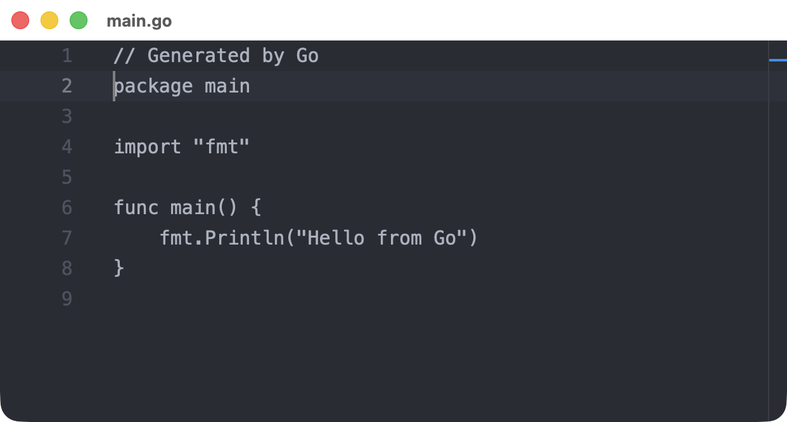{width=621}

*After `InsertText`, with the caret at the start of a new editor.*

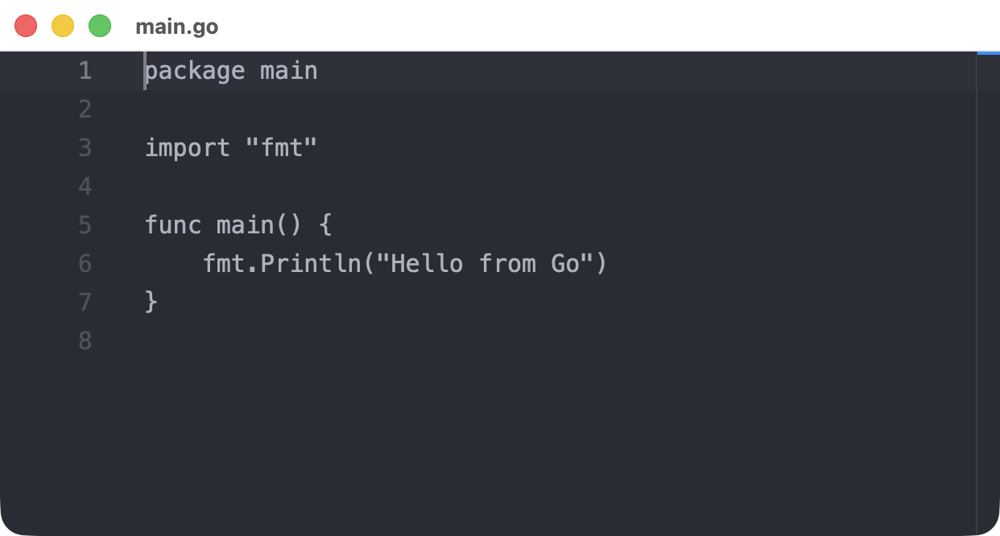{width=621}

*The same window after `Undo`. The opening text has no undo entry, so a further `Undo` changes nothing.*

### Moving the cursor

`SetSelection` takes two `editor.Position` values. Pass the same position twice for a plain cursor:

```go
func GoToLine(ctx context.Context, field *editor.Editor, line uint32) (*editor.State, error) {
	caret := editor.Position{Line: line - 1}
	return field.SetSelection(ctx, caret, caret)
}

func SelectWord(ctx context.Context, field *editor.Editor) (*editor.State, error) {
	return field.SetSelection(ctx, editor.Position{Line: 119, Column: 5}, editor.Position{Line: 119, Column: 8})
}
```

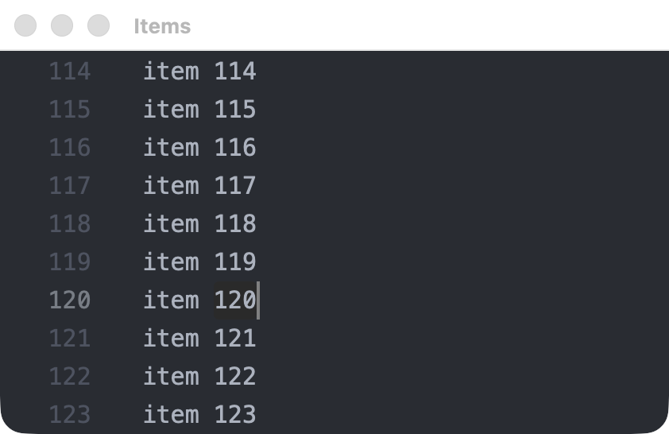{width=421}

*`SelectWord` in a 200-line buffer. The selection scrolled into view by itself.*

| `editor.Position` field | Description |
| --- | --- |
| `Line` | Zero-based line number |
| `Column` | Zero-based visual column: the cells from the start of the line to this position, as the editor lays them out |
| `Character` | An alternative to `Column` when setting a selection: Unicode code points from the start of the line, as `utf8.RuneCountInString` counts them |
| `Clamp` | Where a position inside a wide character, a tab or a grapheme cluster goes |

| Text | Width in `Column` |
| --- | --- |
| East Asian Narrow, Halfwidth and Neutral characters, including ASCII and `ｱ` | 1 |
| East Asian Wide and Fullwidth characters such as `日` and `Ａ`, and emoji | 2 |
| East Asian Ambiguous characters such as `α` and `→` | Set by the editor's `WidthTable` |
| A tab | Up to its next tab stop |
| A combining mark | 0, it shares its base character's cell |
| A control or invisible character | 1, for the placeholder the editor paints |

On a line holding `"\t日\tz"`, with the default tab size of 4, `z` is at column 9. Zed places a tab stop by counting characters rather than cells, so the `日` before the second tab does not move that stop. `Column` reports where the tab really ended, not a multiple of the tab size.

Set `WidthTable` in `Options` or `EmbedOptions` to choose how ambiguous characters count:

| `WidthTable` | `α`, `Я`, `é` | `●`, `→`, `①` |
| --- | --- | --- |
| `editor.WidthNarrowAmbiguous` (default) | 1 | 1 |
| `editor.WidthWideAmbiguous` | 2 | 2 |
| `editor.WidthWideSymbols` | 1 | 2 |

The table changes only the count. Zed draws each glyph from the font, so pick the table closest to the font in use. Menlo draws all of these one cell wide, which suits the default. A Japanese font such as BIZ UDGothic draws `α`, `Я`, `●` and `→` two cells wide, which suits `editor.WidthWideAmbiguous`, but it draws `é` one cell wide. No table matches every font. `editor.WidthWideAmbiguous` follows the Unicode table exactly, while `editor.WidthWideSymbols` also counts a few Neutral characters such as `⅐` as 2.

A column is a count of cells, in the sense a terminal uses, and not a pixel offset. Characters from a fallback font can be drawn a little narrower than two cells: with the default fonts on macOS, `日` is drawn at about 1.7, so text after it sits slightly left of the same column on an ASCII line.

`Column` is not an index into a Go string. `Line` stays a buffer line, so a soft-wrapped line keeps one count across its wrapped rows and resizing the window does not change it.

A position outside the buffer or inside a tab or a character returns `InvalidArgument`, and so does a start after the end. To accept a column that falls inside a wide character or a tab, set `Clamp` on that position:

| `Position.Clamp` | A column inside a wide character or a tab |
| --- | --- |
| `editor.ClampNone` (default) | Returns `InvalidArgument` |
| `editor.ClampBefore` | Moves before it in text order |
| `editor.ClampAfter` | Moves after it in text order |

Each end has its own `Clamp`, so a range can grow to whole characters. On a line starting with `日`, which covers columns 0 and 1, this selects it:

```go
start := editor.Position{Line: 3, Column: 1, Clamp: editor.ClampBefore}
end := editor.Position{Line: 3, Column: 1, Clamp: editor.ClampAfter}
state, err := field.SetSelection(ctx, start, end) // Columns 0 to 2.
```

`Line`, `Column`, `Character` and `Clamp` all follow text order. On a right-to-left line, column 0 is the first character of the text, drawn at the right, and `ClampBefore` moves toward the right of the screen. `Column` measures how far along the text a position is, not its distance from the left edge.

`Character` is the easier choice when you already have a count from Go text. A tab and a wide character are one character each, so on a line holding `"\t日\tz"`, `Character: 3` is the `z` at column 9. A count that falls inside a grapheme cluster, such as between `e` and a combining accent, follows `Clamp`. Setting both `Column` and `Character` to nonzero values returns `InvalidArgument`. `State.Selection` always reports `Column` and leaves `Character` at zero.

`Clamp` only applies inside a character or tab. A column past the end of the line is still an error, and a start that ends up after its end once clamped is too. `State.Selection` always reports positions with `Clamp` unset. Nothing is clamped. The end of the last line is a valid position, including the empty line after a trailing newline.

`SetSelection` replaces any multiple cursors with one selection, works on a read-only editor and does not move keyboard focus. Follow it with `InsertText` to edit at that spot.

`State.Selection` reports the newest selection, with `Start` never after `End`. Moving a selection does not change `Revision` and emits no `Changed` event, so read `State` when you need the current position. `Changed` events also carry the selection at the time of the edit.

## Reacting to changes

`NextEvent` delivers changes in order. Use a single consumer for it, though commands themselves can run concurrently.

| `Event.Kind` | Meaning | Fields |
| --- | --- | --- |
| `editor.Changed` | The text or read-only state changed | `EditorID`, `State` |
| `editor.EditorClosed` | The window was closed | `EditorID` |
| `editor.Failed` | The editor reported an error | `EditorID`, `Error` |

Editors are independent, and each event names the one it came from. This loop mirrors one editor into a read-only preview:

```go
// Mirror copies every edit in source to preview, in uppercase, until ctx ends.
func Mirror(ctx context.Context, app *editor.Client, source, preview *editor.Editor) error {
	for {
		event, err := app.NextEvent(ctx)
		if err != nil {
			return err
		}
		switch {
		case event.Kind == editor.Failed:
			return event.Error
		case event.Kind == editor.EditorClosed && event.EditorID == source.ID():
			return nil
		case event.Kind == editor.Changed && event.EditorID == source.ID():
			if _, err := preview.SetText(ctx, strings.ToUpper(event.State.Text)); err != nil {
				return err
			}
		}
	}
}
```

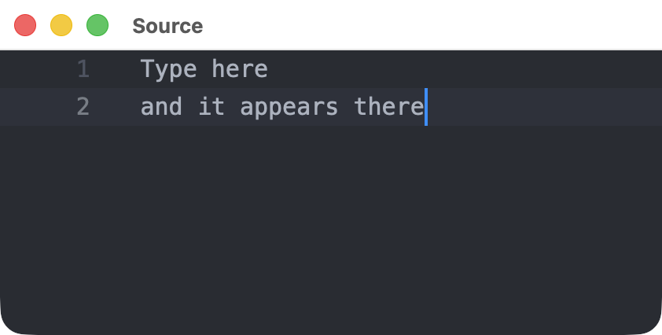{width=421}

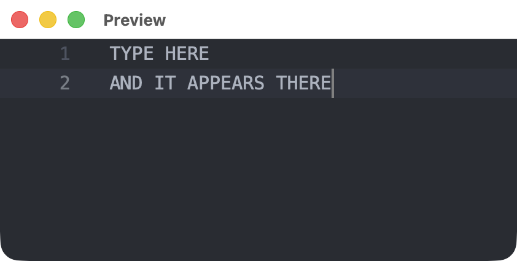{width=421}

*The preview's own `SetText` also produces a `Changed` event, so the loop checks `EditorID`.*

Events have no acknowledgement or replay guarantee, unlike the generic event stream. A canceled command may already have been applied, so do not retry mutations automatically.

## Placing an editor inside a view

An editor can sit inside a `scene.Div` next to ordinary elements. This uses `host.Run`, the same as any other gpui-go application, with the editor added to it.

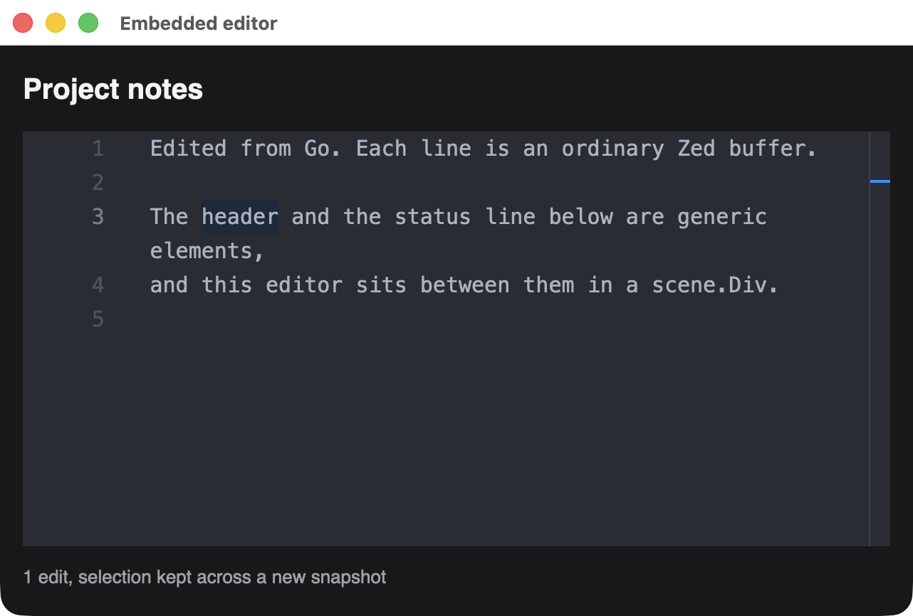{width=641}

*A heading, a live editor and a status line in one `scene.Div`.*

An editor is created inside a window, so open the window first, then add the editor in a later view:

```go
err := host.Run(ctx, func(ctx context.Context, app *client.Client) error {
	window, err := app.OpenWindow(ctx, client.WindowOptions{Title: "Notes", Width: 640, Height: 400}, scene.Div(1))
	if err != nil {
		return err
	}
	editors, err := editor.Attach(ctx)
	if err != nil {
		return err
	}
	field, err := editors.OpenEmbedded(ctx, window, editor.EmbedOptions{Text: notes})
	if err != nil {
		return err
	}
	if err := window.Set(ctx, render(field, "0 edits")); err != nil {
		return err
	}
	// Handle GPUI and editor events here.
})
```

Refer to the editor from your view with `scene.Embedded`, passing its ID. Give it a size through its style, as with any element:

```go
func render(field *editor.Editor, status string) *scene.Node {
	return scene.Div(1,
		scene.Text(2, "Project notes").Style(&scene.Style{FontSize: scene.Ptr[float32](20), FontWeight: scene.Ptr[uint32](600)}),
		scene.Embedded(3, field.ID()).Style(&scene.Style{
			Width: scene.Percent(100), FlexGrow: scene.Ptr[float32](1),
		}),
		scene.Text(4, status).Style(&scene.Style{FontSize: scene.Ptr[float32](13), TextColor: scene.RGB(0xa1a1aa)}),
	).Style(&scene.Style{
		Width: scene.Percent(100), Height: scene.Percent(100), Padding: scene.Padding(16), Gap: scene.Pixels(12),
		FlexDirection: scene.FlexColumn.Enum(), Background: scene.RGB(0x18181b), TextColor: scene.RGB(0xf4f4f5),
		FontSize: scene.Ptr[float32](15),
	})
}
```

The `field` handle has every method from [Editing from Go](#editing-from-go), and `editors.NextEvent` reports its changes.

| Behavior | Details |
| --- | --- |
| New snapshots | The native editor persists, so text, selection and undo history carry over |
| Leaving the view | Removing the element hides the editor without destroying it. Put it back to show it again |
| Closing | `field.Close` destroys it. Closing the window destroys every editor inside it, and each one reports `EditorClosed` |
| Placement rules | An editor appears at most once per view, and only in the window it was created in. Other placements make `window.Set` fail and leave the previous view in place |
| Events | Generic events and editor events are separate streams. See `examples/editor-embed` for one goroutine handling both |

### Building with an embedded editor

This links the generic backend and the GPL editor into one archive, so the [license notice](#zed-editor) applies to your whole application. Ordinary builds are unaffected.

```sh
CARGO_TARGET_DIR=target/zed-editor \
  cargo build --locked --manifest-path rust/zed-editor/embed/Cargo.toml
```

```sh
CGO_LDFLAGS="/path/to/gpui-go/target/zed-editor/debug/libgpui_go_zed_editor_embed.a" \
  go build -a -mod=mod -tags gpui,sable_extern_lib,sable_portable,gpui_zed_editor_embed -o app .
```

From a checkout, `make editor-embed` runs the example. Without the `gpui_zed_editor_embed` tag, `editor.Attach` returns `ErrNativeUnavailable`, and a backend without the feature rejects `scene.Embedded`.

## Building

Build the host from a checkout, then link it with the editor tags:

```sh
CARGO_TARGET_DIR=target/zed-editor \
  cargo build --locked --manifest-path rust/zed-editor/host/Cargo.toml
```

```sh
CGO_LDFLAGS="-L/path/to/gpui-go/target/zed-editor/debug -lgpui_go_zed_editor_host" \
  go build -a -mod=mod -tags gpui_zed_editor,sable_extern_lib,sable_portable -o app .
```

The first build compiles Zed's editor and takes a while. Without these tags the program still compiles, and `editor.Run` returns `ErrNativeUnavailable`. [Prebuilt modules](./prebuilt-modules) never include this backend.

## Limits

| Limit | Value |
| --- | --- |
| Text per editor | 1 MiB |
| Open editors | 64 |

Syntax grammars, language servers and file or project services are not configured. See [Extending the editor](#extending-the-editor) for how to add them, or embed the [Rust component](https://github.com/moriyoshi/gpui-go/blob/main/rust/zed-editor/README.md) directly.

## Extending the editor

The editor ships as plain text on purpose, but it wraps Zed's full `editor::Editor`, so more of Zed can be switched on. Your changes become part of the GPL-licensed component described in the [license notice](#zed-editor) above.

### Where changes go

An option that Go can use crosses four layers. Work through them in this order:

| Layer | File | Role |
| --- | --- | --- |
| Rust component | `rust/zed-editor/src/lib.rs` | The editing behavior, with no knowledge of Go |
| Protocol | `proto/gpui/editor/v1/editor.proto` | The versioned messages between Go and Rust |
| Rust host | `rust/zed-editor/host/src/lib.rs` | Turns messages into component calls, and validates them |
| Go client | `editor/editor.go` | The public `editor` API |

A Rust application that embeds the component directly only needs the first layer. Go and Rust only ever exchange protobuf messages, so add new fields with new numbers instead of passing anything else across.

### Syntax highlighting

Zed ships grammars and highlight queries for common languages. These steps add a `Language` option for Go source.

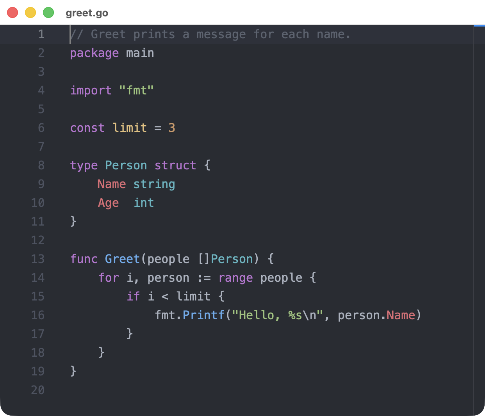{width=621}

*The real editor, opened with `Language: "go"` after following these steps.*

#### 1. Add the dependencies

In `rust/zed-editor/Cargo.toml`, use the same Zed revision as the other dependencies. The grammar's revision comes from Zed's own [`Cargo.toml`](https://github.com/zed-industries/zed/blob/e231594b6b8818ea8d668ee2eb73e1fb09300654/Cargo.toml).

```toml
[dependencies]
anyhow = "1"
grammars = { git = "https://github.com/zed-industries/zed", rev = "e231594b6b8818ea8d668ee2eb73e1fb09300654" }
theme = { git = "https://github.com/zed-industries/zed", rev = "e231594b6b8818ea8d668ee2eb73e1fb09300654" }
tree-sitter-go = { git = "https://github.com/zed-industries/tree-sitter-go", rev = "6862a49e3c5a7567a6c576420e9a8f944e198a85" }
```

#### 2. Load the language and apply it

In `rust/zed-editor/src/lib.rs`, build a `Language` from the bundled grammar and queries. It needs the theme's colors, or everything renders in one color.

```rust
use language::Language;
use std::sync::Arc;
use theme::ActiveTheme;

/// Build a highlighted language from the grammars bundled with Zed.
pub fn load_language(name: &str, cx: &App) -> anyhow::Result<Arc<Language>> {
    let grammar = match name {
        "go" => tree_sitter_go::LANGUAGE,
        other => anyhow::bail!("no grammar for language {other:?}"),
    };
    let language = Language::new(grammars::load_config(name), Some(grammar.into()))
        .with_queries(grammars::load_queries(name))?;
    language.set_theme(cx.theme().syntax());
    Ok(Arc::new(language))
}
```

Then add a method to `EditorComponent`:

```rust
/// Parse this editor's buffer as `language` and highlight it.
pub fn set_language(&mut self, language: Arc<Language>, cx: &mut Context<Self>) {
    self.editor.update(cx, |editor, cx| {
        if let Some(buffer) = editor.buffer().read(cx).as_singleton() {
            buffer.update(cx, |buffer, cx| buffer.set_language(Some(language), cx));
        }
    });
}
```

A Rust application can stop here, calling `load_language` and `set_language` from its own view.

#### 3. Add the protocol field

```proto
message Open {
  // ...existing fields...
  bool soft_wrap = 7;
  string language = 8;
}
```

#### 4. Apply it in the host

In the `Open` branch of `rust/zed-editor/host/src/lib.rs`, load the language right after validation, so that an unknown name fails before a window opens:

```rust
let language = if value.language.is_empty() {
    None
} else {
    Some(
        gpui_go_zed_editor::load_language(&value.language, cx)
            .map_err(|e| error(ErrorCode::InvalidArgument, e.to_string()))?,
    )
};
```

Inside the window closure, once the component exists:

```rust
if let Some(language) = language {
    component.update(cx, |component, cx| component.set_language(language, cx));
}
```

#### 5. Expose it in Go

In `editor/editor.go`, add `Language string` to `Options`, and pass it in the `pb.Open` message that `Client.Open` sends:

```go
&pb.Open{Language: options.Language, Title: options.Title /* ...existing fields... */}
```

#### 6. Build and use it

Regenerate the protobuf code, then build once without `--locked` so that Cargo records the new packages. That adds only `grammars` and `tree-sitter-go` to the lockfile. Do not run `cargo update`, which would move other pinned dependencies.

```sh
make generate
CARGO_TARGET_DIR=target/zed-editor cargo build --manifest-path rust/zed-editor/host/Cargo.toml
make editor
```

```go
field, err := app.Open(ctx, editor.Options{Title: "greet.go", Text: source, Language: "go"})
```

An unknown name returns an error with `InvalidArgument`, such as `no grammar for language "cobol"`.

#### Adding more languages

Each language needs its grammar crate and one more `match` arm. The name must match a directory in Zed's [`crates/grammars/src`](https://github.com/zed-industries/zed/tree/e231594b6b8818ea8d668ee2eb73e1fb09300654/crates/grammars/src), such as `rust`, `python`, `json`, `yaml`, `bash`, `c`, `cpp`, `css` or `typescript`. Copy each crate's version from Zed's `Cargo.toml`.

Only Go has been run so far. The others follow the same pattern, but a language that embeds another, such as Markdown, may need a language registry as well. Each grammar also adds to build time and binary size.

### Fonts and other settings

The host passes Zed's settings as JSON in `initialize`, in `rust/zed-editor/host/src/lib.rs`. To change the font size, add a key to that string:

```rust
store.set_user_settings(r#"{"buffer_font_size":24,"buffer_font_family":"Menlo", ...}"#, cx);
```

Any [Zed setting](https://zed.dev/docs/configuring-zed) the editor reads can go here. Options set per editor from Go, such as `HideGutter`, are separate and live in `EditorComponent::new`.

### Saving to files

This one needs no Rust. The Go client already delivers the whole text with every change:

```go
// SaveOnChange writes each edit in field to path until the editor closes.
func SaveOnChange(ctx context.Context, app *editor.Client, field *editor.Editor, path string) error {
	for {
		event, err := app.NextEvent(ctx)
		if err != nil {
			return err
		}
		if event.EditorID != field.ID() {
			continue
		}
		switch event.Kind {
		case editor.Changed:
			if err := os.WriteFile(path, []byte(event.State.Text), 0o644); err != nil {
				return err
			}
		case editor.Failed:
			return event.Error
		case editor.EditorClosed:
			return nil
		}
	}
}
```

Run it instead of your usual event loop. For large files, write less often than every keystroke, since each event carries the full text.

### New commands from Go

To add an operation such as "select all", follow an existing command like `SetReadOnly` through the layers:

1. Add a message and a new `oneof command` field in `editor.proto`.
2. Add a method on `EditorComponent`. Use `native_editor()` to reach Zed's API.
3. Add a match arm for the command in the host.
4. Add a method on `Editor` in `editor/editor.go` that uses `stateCommand`.
5. Exercise it in `examples/editor/smoke.go`, because a fake transport cannot prove what Zed does.

After a change that does not emit Zed's buffer-edited event, call `state` so that Go sees the new revision.

### Key bindings

`bind_default_keys` in `rust/zed-editor/src/lib.rs` installs a basic set of macOS shortcuts using `cmd`. For Linux or Windows, or for more commands, add entries beside them using Zed's actions, in the `Editor` context:

```rust
KeyBinding::new("ctrl-a", SelectAll, Some("Editor")),
```

### Larger enhancements

These have no tested recipe yet:

| Enhancement | What it involves |
| --- | --- |
| Other themes | The host loads only Zed's base theme, through `LoadThemes::JustBase`. Others need the theme assets loaded and selected |
| Language servers | `EditorComponent::new` passes no `Project` to Zed. Completions and diagnostics need a project and language server setup |

### Checking your change

```sh
cargo fmt --manifest-path rust/zed-editor/Cargo.toml --all
cargo clippy --locked --manifest-path rust/zed-editor/Cargo.toml --workspace -- -D warnings
make editor-smoke
go test ./editor
```

`make editor-smoke` drives real Zed editors through commands, but it does not type. Try keyboard and IME changes by hand with `make editor`.

Go's build cache does not track the Rust archive, so keep `-a` when you link your own program.
