# GoX templates

[GoX](https://github.com/doors-dev/gox) (pinned to v0.3.3) lets you write [reactive components](./reactive) as markup in `.gox` files that compile to checked-in Go. You need the GoX tool only to regenerate that Go, not for ordinary builds.

```text
elem Counter(count *reactive.Signal[int]) {
	<span testid="counter">
		~(nativegox.Text(func() string { return fmt.Sprintf("Count: %d", count.Get()) }))
	</span>
}
```

Build the generated component through the native printer:

```go
root, err := nativegox.Build(ctx, document, document.Scope(), Counter(count))
```

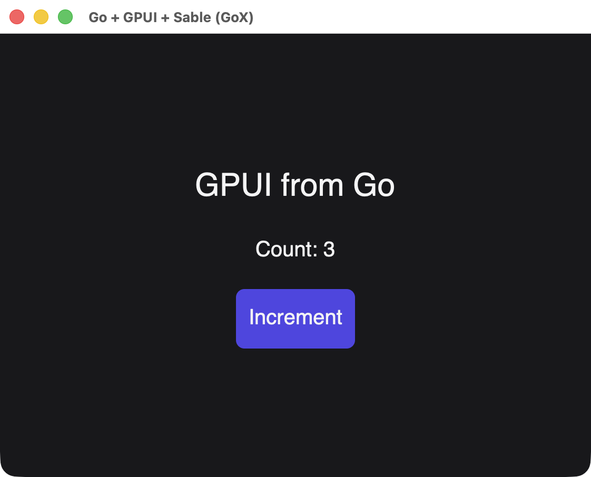{width=561}

The tags are native GPUI elements rather than HTML. See [GoX tags](/reference/gox-tags) for every tag and attribute. Every screenshot on this page is a real window built from the template shown beside it.

## Anatomy of a template

| Syntax | Meaning |
| --- | --- |
| `elem Name(args) { ... }` | A function returning `gox.Elem`. Its body runs when `Build` reaches it |
| `<div> ... </div>` | A native element. It is a Go expression, so you can pass it around |
| `name="text"`, `name=(expr)` | An attribute with a literal or a Go value |
| `~(expr)` | Output as a child: a string, a number, a `gox.Elem`, a `*ui.Node` or a `nativegox.Text` |
| `~(if ...)`, `~(for ...)` | A condition or loop that runs once, during `Build` |
| `<> ... </>` | A fragment, which groups children without adding an element |
| `~~ ... ~~` | Plain Go statements inside a template |

`Build` runs the component once and requires exactly one root element. After that, only [bindings](#text-that-changes) update, so a `~~ ~~` block never runs again.

## Reusable components

A component is a function, and its parameters are ordinary typed Go. Output another component with `~( )`:

```text
elem Badge(text string, color uint32) {
	<span
		style=(&scene.Style{
			Padding: scene.Padding(6),
			Background: scene.RGB(color),
			CornerRadius: scene.Ptr[float32](6),
		})>
		~(text)
	</span>
}

elem Tags() {
	<div style=(rowStyle)>
		~(Badge("Stable", 0x0d9488))
		~(Badge("Beta", 0xb45309))
		~(Badge("Deprecated", 0xbe123c))
	</div>
}
```

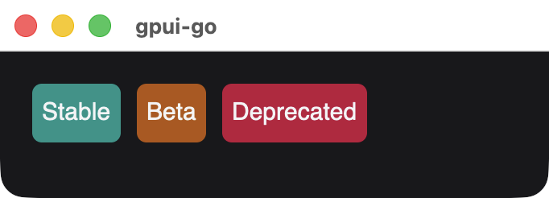{width=341}

`rowStyle` is an ordinary `*scene.Style`. A `.gox` file is a Go file, so it can hold declarations like this one, and elements can share a style value:

```text
var rowStyle = &scene.Style{FlexDirection: scene.FlexRow.Enum(), Gap: scene.Pixels(10), AlignItems: scene.AlignCenter.Enum()}
```

## Passing children

Take a `gox.Elem` parameter to accept markup from the caller. A fragment passes several elements as one value:

```text
elem Card(title string, body gox.Elem) {
	<div style=(cardStyle)>
		<span style=(titleStyle)>~(title)</span>
		~(body)
	</div>
}

elem Profile() {
	~(Card("Ada Lovelace", <>
		<span>Analyst</span>
		<span>London</span>
	</>))
}
```

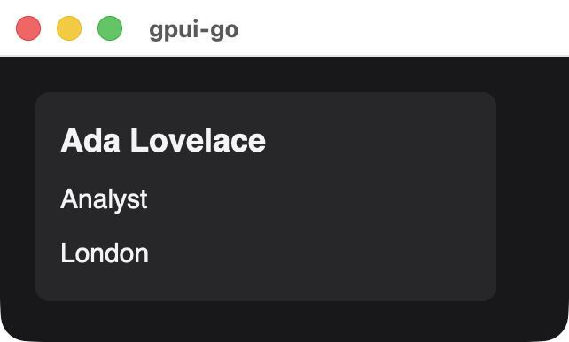{width=321}

## Conditions and loops

`~(if ...)` and `~(for ...)` work with plain Go values:

```text
elem Roster(people []Person) {
	<div style=(columnStyle)>
		~(for _, person := range people {
			<div style=(rowStyle)>
				<span>~(person.Name)</span>
				~(if person.Admin {
					~(Badge("Admin", 0x4f46e5))
				})
			</div>
		})
	</div>
}
```

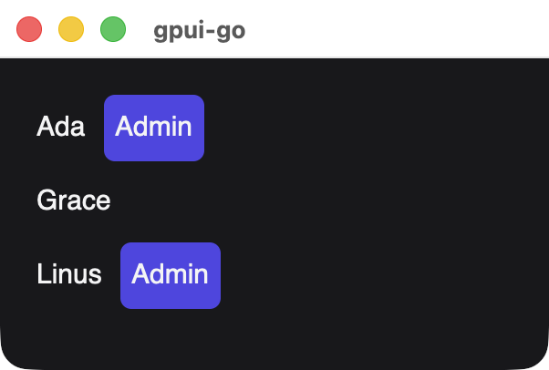{width=301}

::: warning These run once
Template conditions and loops decide the structure during `Build`, and they do not rerun when a signal changes. For structure that changes over time, see [Changing structure](#changing-structure).
:::

## Text that changes

Wrap an accessor in `nativegox.Text` to bind it. Reading a signal directly formats its value once:

```text
elem TextKinds(count *reactive.Signal[int]) {
	<div style=(columnStyle)>
		<span>~(fmt.Sprintf("Formatted once: %d", count.Get()))</span>
		<span>
			~(nativegox.Text(func() string {
				return fmt.Sprintf("Bound to the signal: %d", count.Get())
			}))
		</span>
	</div>
}
```

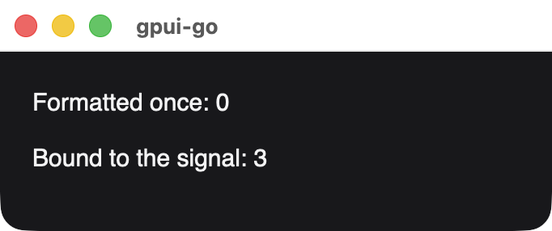{width=341}

*Both lines after setting the signal to 3. Only the bound one updated.*

A bare function as a child is an error, which catches a forgotten `nativegox.Text`.

## One text per line

Literal text and each `~( )` become separate text elements, and a `span` stacks its children because it is a plain container. To get one line, produce one string:

```text
elem MixedText() {
	<div style=(columnStyle)>
		<span>Hello, ~"Ada"!</span>
		<span>~"Hello, Ada!"</span>
	</div>
}
```

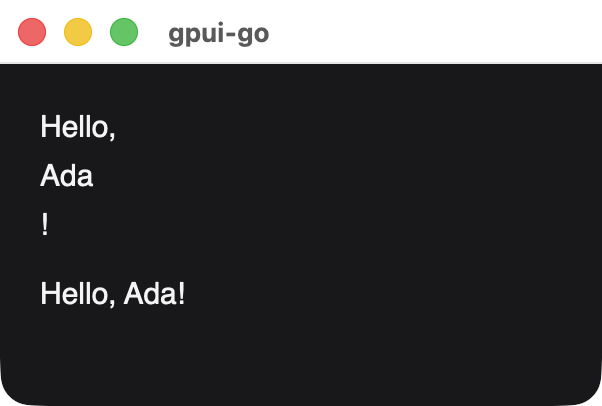{width=301}

For a line that changes, return the whole string from `nativegox.Text`.

## Text inputs

`input` is a void tag bound to a string signal, in both directions. Native edits update the signal, and setting the signal replaces the field's text:

```text
elem NameForm(name *reactive.Signal[string], locked *reactive.Signal[bool]) {
	<div style=(columnStyle)>
		<input
			testid="name"
			label="Name"
			value=(name)
			placeholder="Your name"
			disabled=(locked.Get)
			style=(inputStyle)/>
		<span>
			~(nativegox.Text(func() string {
				return "Hello, " + name.Get()
			}))
		</span>
	</div>
}
```

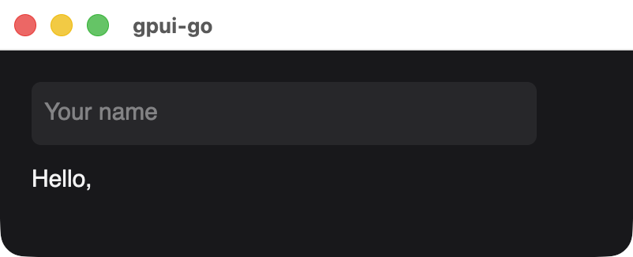{width=401}

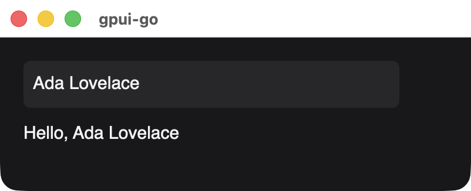{width=401}

*The same window before and after setting the signal from Go.*

`locked.Get` is passed as a method value, so the field re-evaluates it when `locked` changes. Pass a plain `bool` for a fixed state. Add a `label` so that [`GetByRole`](/testing/api#finding-elements) can find the field by name.

## Events and changing styles

`onClick` takes a `ui.Handler`. `style` and `checked` also accept accessors, which update just that property when a signal they read changes:

```text
elem Switch(on *reactive.Signal[bool], flip ui.Handler) {
	<button
		label="Notifications"
		role=(scene.RoleCheckbox)
		checked=(on.Get)
		onClick=(flip)
		style=(func() *scene.Style {
			background := scene.RGB(0x3f3f46)
			if on.Get() {
				background = scene.RGB(0x0d9488)
			}
			return &scene.Style{
				Padding: scene.Padding(12),
				Background: background,
				CornerRadius: scene.Ptr[float32](8),
			}
		})>
		~(nativegox.Text(func() string {
			if on.Get() {
				return "Notifications on"
			}
			return "Notifications off"
		}))
	</button>
}
```

```go
flip := ui.Handler(func(context.Context, *client.Event) error {
	return on.Update(func(value bool) bool { return !value })
})
```

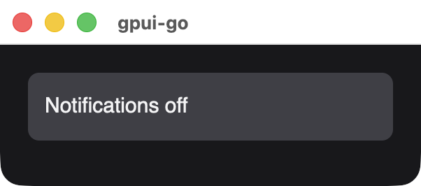{width=301}

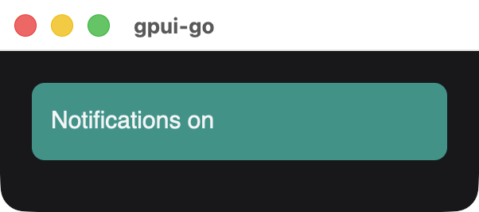{width=301}

A `button` is focusable and has the button role, and `role` replaces that role here. `checked` is accessibility metadata, so the visible state is up to your style.

## Changing structure

Use [`Show` and `For`](/reference/reactive-nodes#show) for structure that follows signals, and embed the resulting node with `~( )`. Each branch or row can be its own template:

```text
elem Board(details, rows *ui.Node) {
	<div style=(columnStyle)>
		~(details)
		~(rows)
	</div>
}

elem Details() {
	~(Badge("Details are open", 0x0d9488))
}

elem TaskRow(task *reactive.Signal[Task], index *reactive.Signal[int]) {
	<span>
		~(nativegox.Text(func() string {
			return fmt.Sprintf("%d. %s", index.Get() + 1, task.Get().Title)
		}))
	</span>
}
```

Build each piece in the scope the factory receives, so it is disposed with its branch or row:

```go
open := reactive.NewSignal(owner, true)
tasks := reactive.NewSignal(owner, []Task{{1, "Write docs"}, {2, "Take screenshots"}, {3, "Deploy"}})
details := document.Show(owner, open.Get, func(scope *reactive.Scope) *ui.Node {
	return mustBuild(ctx, document, scope, Details())
}, nil)
rows := ui.For(document, owner, tasks.Get,
	func(task Task) int { return task.ID },
	func(scope *reactive.Scope, task *reactive.Signal[Task], index *reactive.Signal[int]) *ui.Node {
		return mustBuild(ctx, document, scope, TaskRow(task, index))
	},
)
root, err := nativegox.Build(ctx, document, owner, Board(details, rows))
```

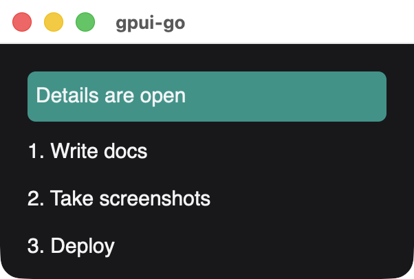{width=301}

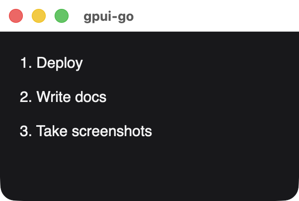{width=301}

*After closing the details and reordering the tasks. The template did not run again, and each row kept its key.*

`mustBuild` panics on failure because factories have no error return. Reactive computations turn that panic into an error and hold back the incomplete snapshot:

```go
func mustBuild(ctx context.Context, document *ui.Document, owner *reactive.Scope, element gox.Elem) *ui.Node {
	node, err := nativegox.Build(ctx, document, owner, element)
	if err != nil {
		panic(err)
	}
	return node
}
```

## Errors

`Build` reports unsupported markup as an error, prefixed with `gox GPUI:`.

| Message | Cause |
| --- | --- |
| `unsupported native tag "img"` | Only `div`, `span`, `text`, `button` and `input` exist |
| `unsupported attribute "class"` | The attribute is not in the [attribute table](/reference/gox-tags#attributes) |
| `expected one root, got 2` | The component must produce exactly one root element |
| `fragment attributes are unsupported` | `<>` takes no attributes |
| `input must be a void head` | Write `<input ... />`, with no children or closing tag |
| `input value requires a string signal` | `value` must be a `*reactive.Signal[string]` |
| `value/placeholder/disabled/masked require input` | Those attributes only apply to `input` |
| `wrap reactive text accessors with gox.Text` | A bare function was output as a child. Use `nativegox.Text` |

## Generating the Go

Edit the `.gox` file, and let the generator write the `.x.go` file beside it. Check that file in, so ordinary builds need no generator:

```text
view.gox     # edit this
view.x.go    # generated, do not edit
generate.go  # go:generate directives
```

```go
package app

//go:generate gox gen view.gox
//go:generate gofmt -w view.x.go
```

Install a `gox` release [matching the runtime](https://github.com/doors-dev/gox/releases) in your `go.mod`, because generated files refuse a mismatched version. Format and regenerate with:

```sh
gox fmt -no-go view.gox
go generate ./...
```

Run `gox gen` after `gox fmt`, since formatting moves source positions. In a gpui-go checkout, `make gox-tools` installs the pinned version in `bin/gox`, and `make check-gox-generated` confirms that the checked-in Go is current.

For editing, see [Vim syntax support](https://github.com/moriyoshi/gpui-go/blob/main/misc/editors/vim/README.md). For how the adapter works, see the [GoX adapter guide](https://github.com/moriyoshi/gpui-go/blob/main/ui/gox/README.md).
