# Reactive components

If rebuilding the whole tree by hand gets tedious, `reactive` and `ui` offer a signal graph in the style of SolidJS. A component is a function that builds its nodes once. Reading a signal inside a binding records a dependency, and when that signal changes, only the affected properties update.

```go
func Counter(document *ui.Document, owner *reactive.Scope, count *reactive.Signal[int]) *ui.Node {
	label := document.BindText(owner, func() string {
		return fmt.Sprintf("Count: %d", count.Get())
	})
	button := document.Div(owner, document.Text(owner, "Increment")).
		Accessible("Increment", &scene.Accessibility{Role: scene.RoleButton}).
		Focusable(0).
		OnClick(func(context.Context, *client.Event) error {
			return count.Update(func(value int) int { return value + 1 })
		}).
		Style(buttonStyle())
	return document.Div(owner, label, button).Style(stackStyle())
}
```

Create a graph and a document, then mount the component:

```go
graph := reactive.NewGraph()
defer graph.Dispose()
document := ui.New(graph.Root(), app)
owner := document.Scope()

count := reactive.NewSignal(owner, 0)
mount, err := document.OpenWindow(ctx, client.WindowOptions{
	Title: "Reactive counter", Width: 500, Height: 300,
}, Counter(document, owner, count))
if err != nil {
	return err
}
defer mount.Close(context.Background())
return app.DispatchEvents(ctx)
```

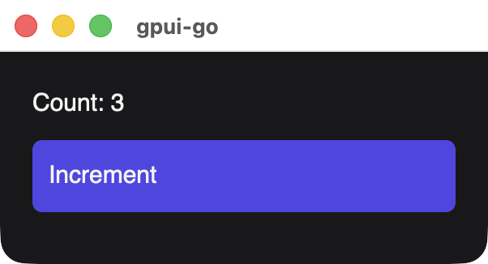{width=301}

Every screenshot on this page is a real window built by the code shown beside it. `stackStyle` and `buttonStyle` are plain functions returning a `*scene.Style`. See [Reactive nodes](/reference/reactive-nodes) for every node constructor and method, and [GoX templates](./gox) to write these components as markup.

## The pieces

| Piece | Created with | Purpose |
| --- | --- | --- |
| Signal | `reactive.NewSignal` | A value that bindings can depend on |
| Memo | `reactive.NewMemo` | A cached value derived from signals |
| Binding | `BindText`, `BindStyle`, `BindAccessibility` | A node property computed from signals |
| Effect | `reactive.NewEffect` | Runs code outside the UI when signals change |
| Scope | `document.Scope()`, `Scope.Child` | Owns all of the above, and cleans them up together |

| Signal method | Description |
| --- | --- |
| `Get()` | Reads the value and records a dependency when called inside a binding, memo or effect |
| `Peek()` | Reads the value without recording a dependency |
| `Set(value)` | Replaces the value and updates its dependents before returning |
| `Update(fn)` | Sets the value computed from the current one |

Treat values as immutable. Signals compare with `reflect.DeepEqual` by default, so mutating a slice or map in place can go unnoticed. Pass a new value to `Set`. To change the comparison, give a typed equality function as the constructor's last argument, or `nil` to always notify.

## Only what changed updates

Each binding depends on exactly the signals it read during its last run:

```go
func TwoLabels(document *ui.Document, owner *reactive.Scope, a, b *reactive.Signal[int]) *ui.Node {
	runsA, runsB := 0, 0
	labelA := document.BindText(owner, func() string {
		runsA++
		return fmt.Sprintf("A is %d (binding runs: %d)", a.Get(), runsA)
	})
	labelB := document.BindText(owner, func() string {
		runsB++
		return fmt.Sprintf("B is %d (binding runs: %d)", b.Get(), runsB)
	})
	return document.Div(owner, labelA, labelB).Style(stackStyle())
}
```

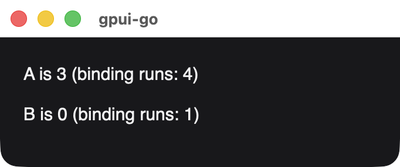{width=341}

*After setting A three times. The binding for B never ran again.*

Dependencies are recalculated on every run, so a binding that reads a signal only on one branch of an `if` stops depending on it when it takes the other branch.

## Derived values

A memo caches a calculation, and only notifies its dependents when the result changes:

```go
func ParityLabels(document *ui.Document, owner *reactive.Scope, count *reactive.Signal[int]) *ui.Node {
	parity := reactive.NewMemo(owner, func() string {
		if count.Get()%2 == 0 {
			return "even"
		}
		return "odd"
	})
	countRuns, parityRuns := 0, 0
	countLabel := document.BindText(owner, func() string {
		countRuns++
		return fmt.Sprintf("Count is %d (binding runs: %d)", count.Get(), countRuns)
	})
	parityLabel := document.BindText(owner, func() string {
		parityRuns++
		return fmt.Sprintf("Parity is %s (binding runs: %d)", parity.Get(), parityRuns)
	})
	return document.Div(owner, countLabel, parityLabel).Style(stackStyle())
}
```

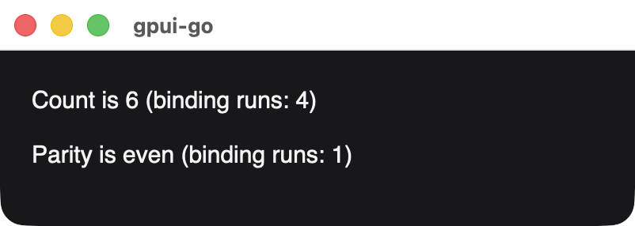{width=401}

*After setting the count to 2, 4 and 6. The parity stayed even, so its label did not run again.*

Keep memo calculations pure. Writing a signal inside one returns `ErrMemoWrite`.

## Batching

Outside a batch, every `Set` updates its dependents immediately. `graph.Batch` applies several writes first and updates once:

```go
func FullName(document *ui.Document, owner *reactive.Scope, caption string, first, last *reactive.Signal[string]) *ui.Node {
	runs := 0
	return document.BindText(owner, func() string {
		runs++
		return fmt.Sprintf("%s: %s %s (binding runs: %d)", caption, first.Get(), last.Get(), runs)
	})
}

func RenameSeparately(first, last *reactive.Signal[string]) error {
	if err := first.Set("Grace"); err != nil {
		return err
	}
	return last.Set("Hopper")
}

func RenameInBatch(graph *reactive.Graph, first, last *reactive.Signal[string]) error {
	return graph.Batch(func() error {
		if err := first.Set("Grace"); err != nil {
			return err
		}
		return last.Set("Hopper")
	})
}
```

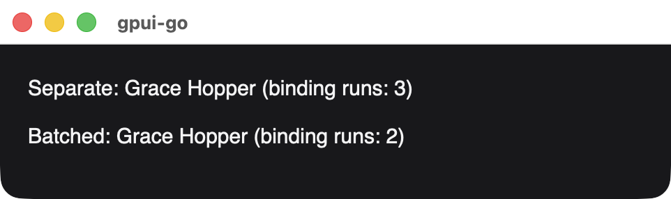{width=481}

*The separate update also published a window showing the half-updated name Grace Lovelace.*

Event handlers are batched automatically. Use `Batch` for updates that start elsewhere. Errors do not roll back writes that have already happened.

## Changing styles

`BindStyle` recomputes a node's whole style when a signal it reads changes:

```go
func StatusTile(document *ui.Document, owner *reactive.Scope, healthy *reactive.Signal[bool]) *ui.Node {
	text := document.BindText(owner, func() string {
		if healthy.Get() {
			return "All systems normal"
		}
		return "Service degraded"
	})
	return document.Div(owner, text).BindStyle(func() *scene.Style {
		background := scene.RGB(rose)
		if healthy.Get() {
			background = scene.RGB(teal)
		}
		return &scene.Style{Padding: scene.Padding(14), Background: background, CornerRadius: scene.Ptr[float32](8)}
	})
}
```

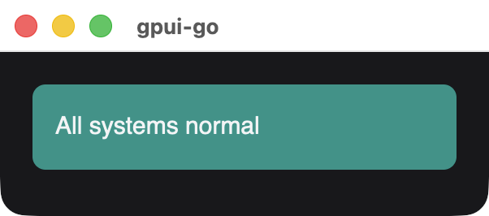{width=301}

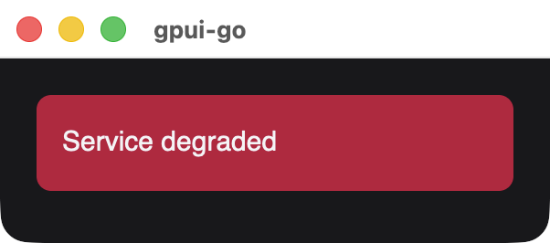{width=301}

`BindAccessibility` does the same for accessibility metadata, such as a checkbox's checked state.

## Forms

`Document.Input` binds a native field to a string signal in both directions, so ordinary memos and bindings can validate it as the user types:

```go
func SignupForm(document *ui.Document, owner *reactive.Scope, name *reactive.Signal[string]) *ui.Node {
	valid := reactive.NewMemo(owner, func() bool {
		return len(strings.TrimSpace(name.Get())) >= 2
	})
	field := document.Input(owner, name, ui.InputOptions{Placeholder: "Your name"}).
		Accessible("Name", &scene.Accessibility{Role: scene.RoleTextInput}).
		Style(fieldStyle())
	message := document.BindText(owner, func() string {
		if valid.Get() {
			return "Hello, " + strings.TrimSpace(name.Get())
		}
		return "Enter at least 2 characters"
	}).BindStyle(func() *scene.Style {
		if valid.Get() {
			return &scene.Style{TextColor: scene.RGB(0x5eead4)}
		}
		return &scene.Style{TextColor: scene.RGB(0xfda4af)}
	})
	return document.Div(owner, field, message).Style(stackStyle())
}
```

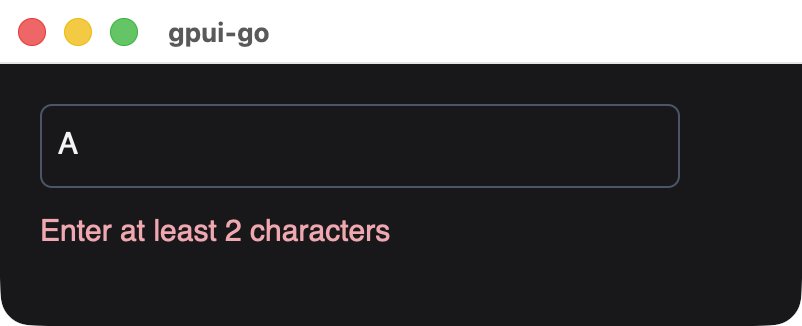{width=401}

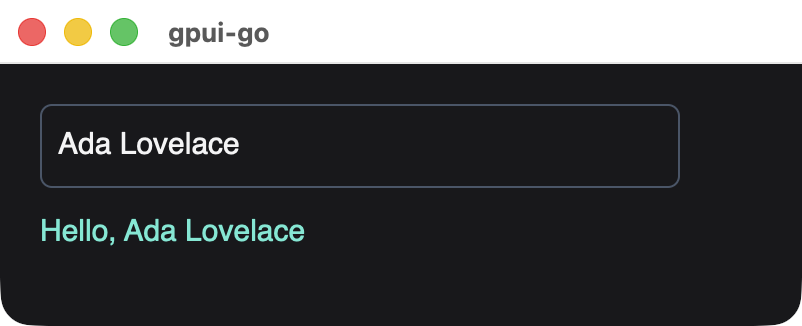{width=401}

Native focus, selection and IME composition stay with the field while the signal changes. `InputOptions.Disabled` takes a function, which may read signals.

## Conditional content

`Document.Show` renders one branch and swaps it when the condition changes. The previous branch's scope, nodes and handlers are disposed:

```go
func Disclosure(document *ui.Document, owner *reactive.Scope, open *reactive.Signal[bool]) *ui.Node {
	heading := document.BindText(owner, func() string {
		if open.Get() {
			return "Hide details"
		}
		return "Show details"
	})
	toggle := document.Div(owner, heading).
		Accessible("Details", &scene.Accessibility{Role: scene.RoleButton}).
		Focusable(0).
		OnClick(func(context.Context, *client.Event) error {
			return open.Update(func(value bool) bool { return !value })
		}).
		Style(buttonStyle())
	details := document.Show(owner, open.Get, func(scope *reactive.Scope) *ui.Node {
		scope.OnCleanup(func() {
			// Release anything this branch started.
		})
		return document.Div(scope,
			document.Text(scope, "Signals drive this branch."),
			document.Text(scope, "Closing it disposes these nodes."),
		).Style(stackStyle())
	}, nil)
	return document.Div(owner, toggle, details).Style(stackStyle())
}
```

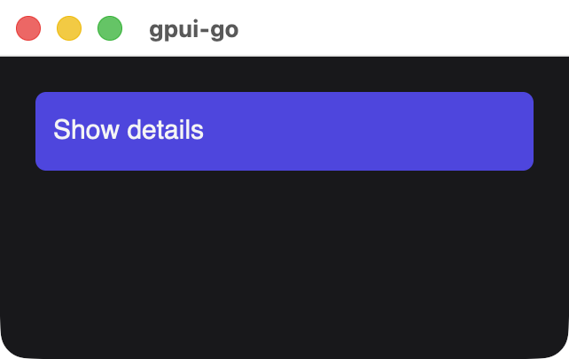{width=321}

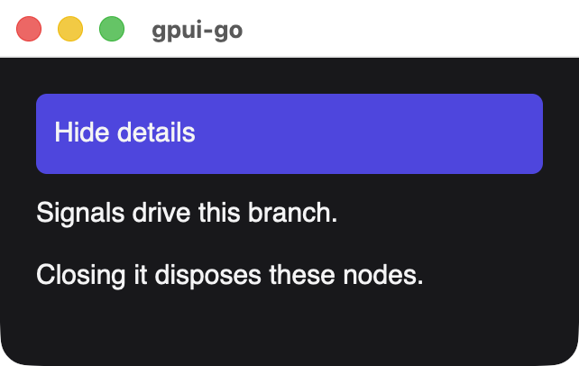{width=321}

Branch factories run untracked, so put reactive reads inside bindings created in the scope the factory receives. Either factory can be nil to render nothing.

## Lists

`ui.For` keeps one row per key. The render function runs once per new key, and receives signals for the item and its position:

```go
func TodoList(document *ui.Document, owner *reactive.Scope, todos *reactive.Signal[[]Todo]) *ui.Node {
	builds := 0
	rows := ui.For(document, owner, todos.Get,
		func(todo Todo) int { return todo.ID },
		func(scope *reactive.Scope, todo *reactive.Signal[Todo], index *reactive.Signal[int]) *ui.Node {
			builds++
			build := builds
			return document.BindText(scope, func() string {
				mark := " "
				if todo.Get().Done {
					mark = "x"
				}
				return fmt.Sprintf("%d. [%s] %s (built as row %d)", index.Get()+1, mark, todo.Get().Title, build)
			})
		},
	)
	return document.Div(owner, rows).Style(stackStyle())
}

func CompleteTodo(todos *reactive.Signal[[]Todo], id int) error {
	next := slices.Clone(todos.Peek())
	for i := range next {
		if next[i].ID == id {
			next[i].Done = true
		}
	}
	return todos.Set(next)
}
```

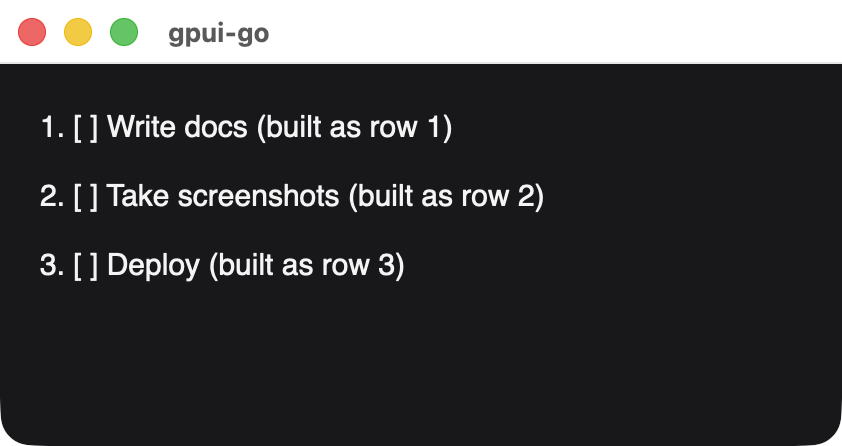{width=421}

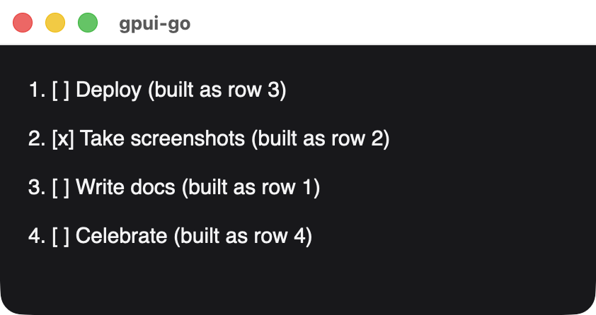{width=421}

*After completing a task, reversing the list and adding a row. Existing rows were updated and moved, not rebuilt, and only the new key was built.*

Because rows are retained, a text field inside a row keeps its focus and selection when the list is reordered. Keys must be unique and stay the same for an item's lifetime. Removing a key disposes its row.

## Effects

Use an effect for work outside the UI tree, such as a window command:

```go
func SyncTitle(ctx context.Context, owner *reactive.Scope, window *client.Window, unread *reactive.Signal[int]) error {
	_, err := reactive.NewEffect(owner, func(*reactive.Scope) error {
		return window.SetTitle(ctx, fmt.Sprintf("Inbox (%d unread)", unread.Get()))
	})
	return err
}
```

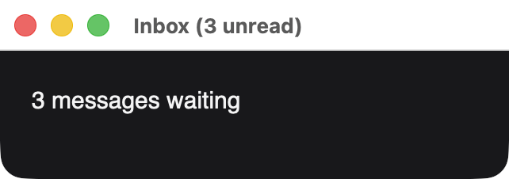{width=321}

The effect runs immediately and again whenever a signal it read changes. It receives a scope for that run: `OnCleanup` callbacks registered there run before the next evaluation, so an effect can release what its previous run acquired.

## Background work

A graph belongs to one goroutine, so results from other goroutines have to reach it first. Replace `DispatchEvents` with a loop that receives both:

```go
func RunWithResults(ctx context.Context, app *client.Client, results <-chan int, progress *reactive.Signal[int]) error {
	type received struct {
		events []*client.Event
		err    error
	}
	batches := make(chan received, 1)
	go func() {
		for {
			events, err := app.NextEvents(ctx)
			select {
			case batches <- received{events, err}:
			case <-ctx.Done():
				return
			}
			if err != nil {
				return
			}
		}
	}()
	for {
		select {
		case <-ctx.Done():
			return ctx.Err()
		case value := <-results:
			if err := progress.Set(value); err != nil {
				return err
			}
		case batch := <-batches:
			if batch.err != nil {
				return batch.err
			}
			for _, event := range batch.events {
				if err := app.Dispatch(ctx, event); err != nil {
					return err
				}
			}
		}
	}
}
```

## Errors and limits

- Fluent methods such as `Style` record errors. Check `document.Err()`, which also prevents mounting.
- A computation that fails or panics reports an error and holds back new snapshots until it recovers.
- An effect that keeps triggering itself stops with an error after 1,000 runs in one update.
- After mounting, group direct node changes such as `SetChildren` in `graph.Batch`, or call `graph.Flush` afterward. Signal updates and event handlers already do this.
- Close the `Mount` before shutting down the client, because disposing a graph does not close its window.

Updates are fine-grained in Go, but the wire still carries complete snapshots, with the [usual limits](./limits). This is a native node graph, without browser layout or DOM/CSS compatibility. To test these components, see [Testing](/testing/).
