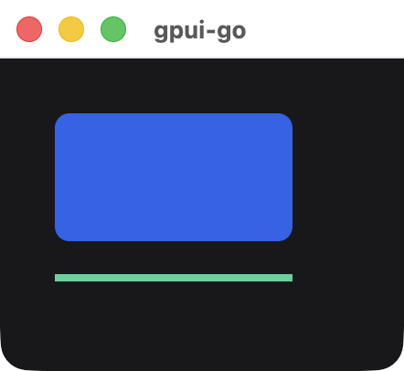
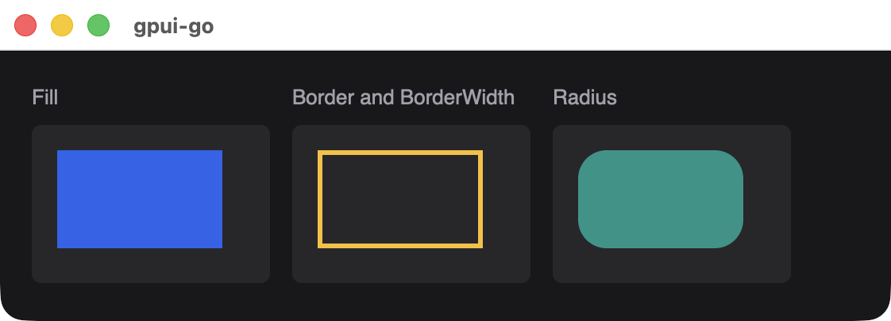
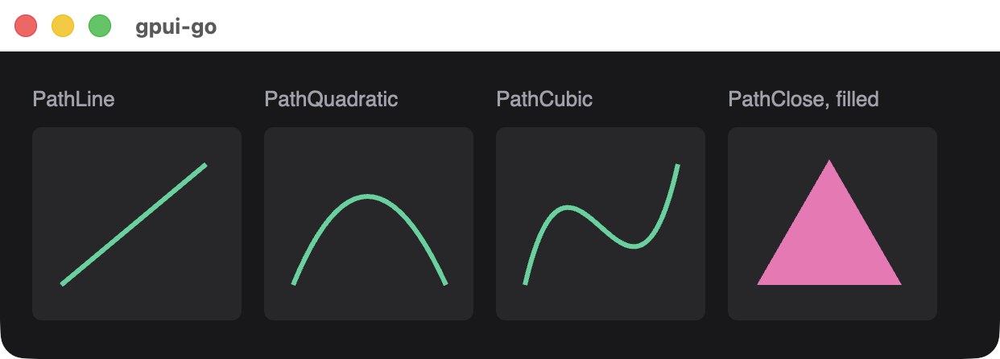

# Canvas

Paints rectangles and vector paths from a list of commands. The commands travel in the snapshot and run entirely in Rust, so no Go callback runs during painting.

```go
chart := scene.Canvas(1,
	&scene.DrawCommand{Kind: &scene.DrawCommandRect{Rect: &scene.DrawRect{
		Bounds: &scene.Bounds{
			Origin: &scene.Point{X: 10, Y: 10},
			Size:   &scene.Size{Width: 130, Height: 70},
		},
		Fill:   scene.RGB(0x2563eb),
		Radius: 8,
	}}},
	&scene.DrawCommand{Kind: &scene.DrawCommandPath{Path: &scene.DrawPath{
		Color:       scene.RGB(0x34d399),
		StrokeWidth: 4,
		Steps: []*scene.PathStep{
			{Verb: scene.PathMove, Point: &scene.Point{X: 10, Y: 100}},
			{Verb: scene.PathLine, Point: &scene.Point{X: 140, Y: 100}},
		},
	}}},
).Style(&scene.Style{
	Width:  scene.Pixels(160),
	Height: scene.Pixels(120),
})
```

{width=221}

## Signature

```text
func Canvas(id uint64, commands ...*DrawCommand) *Node
```

Coordinates are logical pixels relative to the element's top-left corner, and drawing is clipped to the element. The canvas fills its box, so set `Width` and `Height`. Commands paint in order, later ones on top. A canvas cannot have children.

## Rectangle

`scene.DrawCommandRect` wraps a `scene.DrawRect`:

| Field | Type | Description |
| --- | --- | --- |
| `Bounds` | `*scene.Bounds` | Required `Origin` and `Size`. Width and height cannot be negative |
| `Fill` | `*scene.Color` | Fill color. Transparent if nil |
| `Border` | `*scene.Color` | Border color. Transparent if nil |
| `BorderWidth` | `float32` | Border width, at least 0 |
| `Radius` | `float32` | Corner radius, at least 0 |

{width=561}

## Path

`scene.DrawCommandPath` wraps a `scene.DrawPath`:

| Field | Type | Description |
| --- | --- | --- |
| `Steps` | `[]*scene.PathStep` | Required. The first step must be `scene.PathMove` |
| `Color` | `*scene.Color` | Paint color. Transparent if nil |
| `StrokeWidth` | `float32` | 0 fills the path. A larger value strokes it at that width |

Each `scene.PathStep` has a `Verb` and the points it requires:

| Verb | Required fields | Effect |
| --- | --- | --- |
| `scene.PathMove` | `Point` | Starts a new subpath at `Point` |
| `scene.PathLine` | `Point` | Draws a straight line to `Point` |
| `scene.PathQuadratic` | `Point`, `Control1` | Draws a quadratic curve to `Point` |
| `scene.PathCubic` | `Point`, `Control1`, `Control2` | Draws a cubic curve to `Point` |
| `scene.PathClose` | None | Closes the subpath |

{width=621}

## Limits

| Limit | Value |
| --- | --- |
| Commands per canvas | 4096 |
| Path steps per canvas, across all paths | 16,384 |
| Coordinate and size magnitude | 1,000,000 |
| Color channels | 0 to 1, finite |

## Available in other APIs

Canvas is only available through `scene`.
