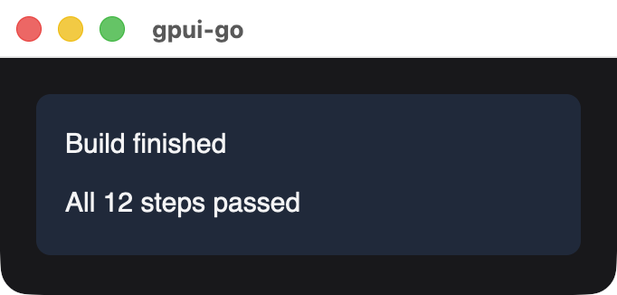
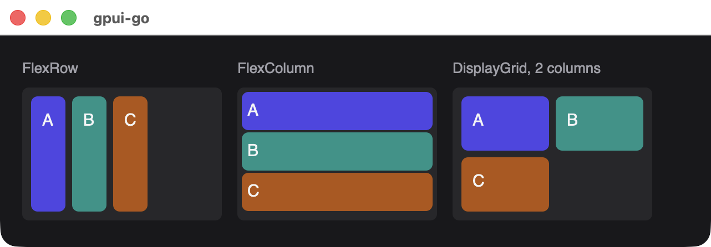
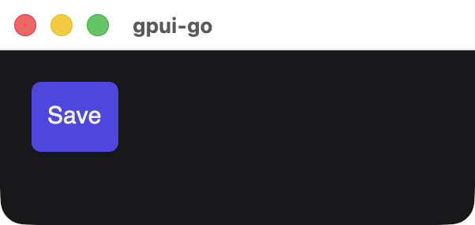

# Container

A container lays out child elements. It is the general-purpose building block: buttons, cards, rows and toolbars are all containers with styles and handlers.

```go
card := scene.Div(1,
	scene.Text(2, "Build finished"),
	scene.Text(3, "All 12 steps passed"),
).Style(&scene.Style{
	FlexDirection: scene.FlexColumn.Enum(),
	Gap:           scene.Pixels(8),
	Padding:       scene.Padding(16),
	Background:    scene.RGB(0x1e293b),
	CornerRadius:  scene.Ptr[float32](8),
})
```

{width=341}

## Signature

```text
func Div(id uint64, children ...*Node) *Node
```

| Parameter | Description |
| --- | --- |
| `id` | Stable nonzero element ID |
| `children` | Child nodes, in paint and layout order. Each is copied. A nil child panics |

## Layout

Setting `FlexDirection` makes the container a flex container. Use `FlexRow` for a row and `FlexColumn` for a column, then `AlignItems`, `JustifyContent`, `Gap` and `FlexWrap` to arrange the children. For a grid, set `Display` to `scene.DisplayGrid` and `GridColumns` to the column count, and leave `FlexDirection` unset. See [Style properties](./style).

Children can scroll when you set `OverflowX` or `OverflowY` to `scene.OverflowScroll`. Scroll position is native state that survives new snapshots while the container's ID stays the same.

{width=641}

## Making a button

There is no dedicated button element. Compose one from a container so you control its appearance:

```go
button := scene.Div(10, scene.Text(11, "Save")).
	Style(&scene.Style{
		Padding:      scene.Padding(10),
		Background:   scene.RGB(0x4f46e5),
		CornerRadius: scene.Ptr[float32](6),
		Cursor:       scene.CursorPointer.Enum(),
	}).
	Hover(&scene.Style{Background: scene.RGB(0x6366f1)}).
	Focusable(0).
	Accessible("Save", &scene.Accessibility{Role: scene.RoleButton}).
	OnClick(handler)
```

{width=301}

`Hover` runs in Rust, with no Go event or new snapshot. A focused element with a click handler can also be activated from the keyboard.

## Available in other APIs

- `ui`: [`Document.Div`](./reactive-nodes#div), which also supports reassigning children with `SetChildren` and `Append`.
- GoX: the [`div`, `span`, `text` and `button` tags](./gox-tags).
