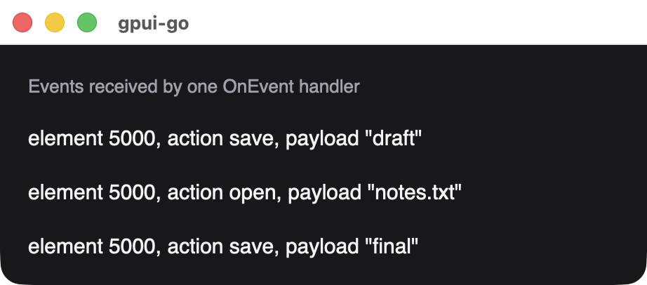

# Events

Register a Go function to get a handler ID, then reference that ID from an element. Handlers run in order on the goroutine that calls `DispatchEvents`, never during painting.

| Registration | Use it with |
| --- | --- |
| `app.OnClick(fn)` | [`Node.OnClick`](./node-methods#onclick) |
| `app.OnEvent(fn)` | [`Node.Interact`](./node-methods#interact), [`BindKey`](./node-methods#bindkey), [`OnAction`](./node-methods#onaction) |
| `app.OnTextChange(fn)` | [`TextInputOptions.OnChange`](./text-input#change-events) |
| `app.RemoveHandler(id)` | Removes a handler. Events already queued for it become harmless |

Each function has the signature `func(context.Context, *client.Event) error`. A handler returning an error stops `DispatchEvents`, which returns that error. Handler IDs are never reused.

## Event fields

Every `*client.Event` carries:

| Field | Description |
| --- | --- |
| `Sequence` | Position in the event stream |
| `Window`, `View` | Handles of the source window and view |
| `Revision` | The view revision the event was captured from |
| `ElementId` | The element that reported the event |
| `HandlerId` | The handler it was dispatched to |

## Payloads by kind

Read the payload with the getter matching the kind. Getters for other kinds return nil, so one handler can serve several event kinds.

| Getter | Reported by | Fields |
| --- | --- | --- |
| `GetClick()` | `OnClick` | `Position`, `Button`, `Modifiers`, `ClickCount` |
| `GetKeyDown()` | `Interaction.KeyDown` | `Key`, `Modifiers`, `Held` |
| `GetKeyUp()` | `Interaction.KeyUp` | `Key`, `Modifiers`, `Held` |
| `GetMouseDown()` | `Interaction.MouseDown` | `Position`, `Button`, `Modifiers` |
| `GetMouseUp()` | `Interaction.MouseUp` | `Position`, `Button`, `Modifiers` |
| `GetMouseMove()` | `Interaction.MouseMove` | `Position`, `Button`, `Modifiers`, `Dragging` |
| `GetScroll()` | `Interaction.Scroll` | `Position`, `Modifiers`, `Delta` in pixels |
| `GetFocusChanged()` | `Interaction.FocusChanged` | `Focused` |
| `GetFileDrop()` | `Interaction.FileDrop` | `Paths` |
| `GetDataDrop()` | `Interaction.DataDrop` | `Kind`, `Payload`, `Preview` |
| `GetAction()` | Key bindings, `OnAction` | `Name`, `Payload` |
| `GetTextChanged()` | `TextInputOptions.OnChange` | `Value`, `Epoch`, `EditRevision`, `Composing` |

`Modifiers` has the booleans `Control`, `Alt`, `Shift` and `Platform`, where `Platform` is the Command key on macOS. `Button` is `client.MouseLeft`, `client.MouseRight` or `client.MouseMiddle`.

{width=461}

*One handler receiving three actions sent with `Window.DispatchAction`, reading `ElementId` and `GetAction()`.*

Window resizes and color scheme changes are not delivered to handlers. `Dispatch` routes them to the window's own callbacks instead; see [Window size and color scheme](./window-state).

## Handling several kinds

```go
inspect := app.OnEvent(func(ctx context.Context, event *client.Event) error {
	switch kind := event.Kind.(type) {
	case *client.EventMouseDown:
		fmt.Println("down at", kind.MouseDown.Position.X, kind.MouseDown.Position.Y)
	case *client.EventScroll:
		fmt.Println("scrolled", kind.Scroll.Delta.Y)
	}
	return nil
})
```

## Delivery

Events are held until the next `NextEvents` call acknowledges them, so canceling a pending pull can be retried without losing any. Acknowledgement means the batch was received, not that every handler succeeded.
