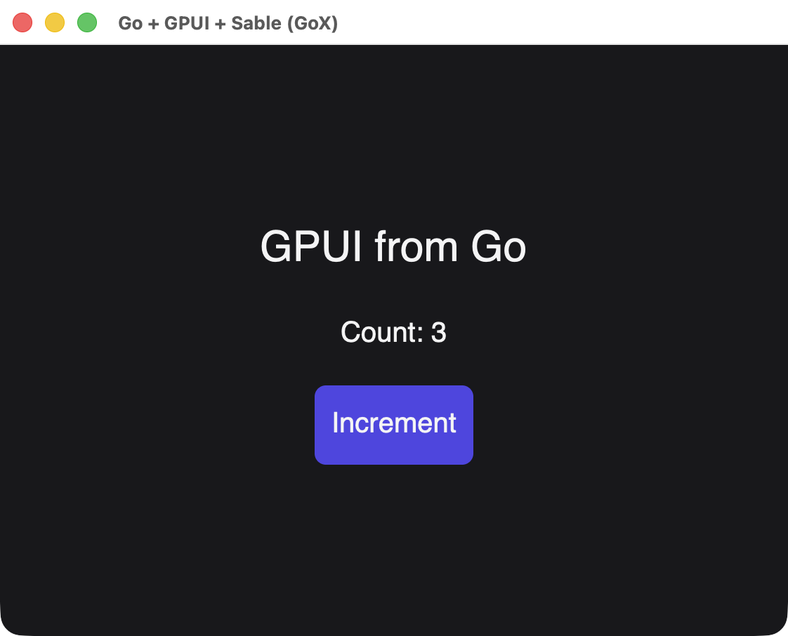

# GoX tags

Tags in a [GoX template](/guide/gox) are native GPUI elements rather than HTML. Unknown tags and attributes make `nativegox.Build` return an error.

| Tag | Builds | Default role |
| --- | --- | --- |
| `div` | [Container](./div) | `RoleGeneric` |
| `span` | Container | `RoleGeneric` |
| `text` | Container | `RoleGeneric` |
| `button` | Focusable container | `RoleButton` |
| `input` | [Text input](./text-input), and must be a void tag | `RoleTextInput` |

`span` and `text` are plain containers for their child text, with no inline layout behavior. GoX's synthetic containers become transparent [fragments](./reactive-nodes#fragment) and accept no attributes.

## Attributes

| Attribute | Applies to | Accepted value |
| --- | --- | --- |
| `testid` | All tags | `string`, registered with the document like [`Name`](./reactive-nodes#node-methods) |
| `label` | All tags | `string` accessibility label |
| `role` | All tags | `scene.AccessibleRole`, other than `RoleUnspecified` |
| `style` | All tags | `*scene.Style`, or `func() *scene.Style` to read signals |
| `onClick` | All tags | `ui.Handler`, or `func(context.Context, *client.Event) error` |
| `checked` | All tags | `bool`, or `func() bool` to read signals |
| `value` | `input` | `*reactive.Signal[string]`, required |
| `placeholder` | `input` | `string` |
| `disabled` | `input` | `bool`, or `func() bool` to read signals |
| `masked` | `input` | `bool`, or `func() bool` to read signals. Draws bullets instead of the text |

## Text content

Literal text between tags becomes a static text node, shown as written with no HTML parsing. For text that changes, wrap an accessor in `nativegox.Text`:

```text
<span>
	~(nativegox.Text(func() string { return fmt.Sprintf("Count: %d", count.Get()) }))
</span>
```

Writing `~(count.Get())` instead formats the value once, and it never updates. A bare function value returns an error. A `*ui.Node` can be embedded as a child, including the result of `Show` and `For`.

## Button

```text
<button label="Increment" onClick=(increment) style=(&scene.Style{
	Padding: scene.Padding(12),
	Background: scene.RGB(0x4f46e5),
})>
	Increment
</button>
```

{width=561}

*The repository's GoX counter example, built from a template using these tags.*

## Input

`input` is a void tag and must have a `value` signal:

```text
<input value=(name) placeholder="Your name" disabled=(locked.Get) />
```

## Building

```text
func Build(ctx context.Context, document *ui.Document, owner *reactive.Scope, element gox.Elem) (*ui.Node, error)
```

`Build` runs the component once and requires exactly one root element. A failed build disposes everything it created.

GoX's own `if` and `for` run during that one construction. For structure that changes over time, use [`Show` and `For`](./reactive-nodes#show) and embed the result.
