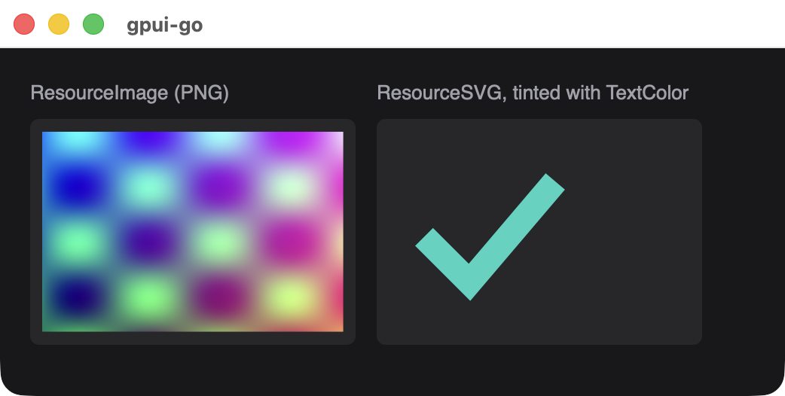
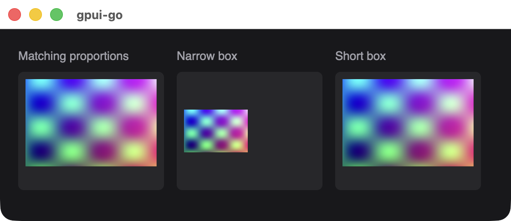

# Image

Displays an uploaded raster image or SVG icon. Image bytes are uploaded once, and snapshots refer to them by handle.

```go
logo, err := app.UploadResource(ctx, client.ResourceImage, "image/png", pngBytes)
if err != nil {
	return err
}

image := scene.Image(1, logo.Handle()).Style(&scene.Style{
	Width:  scene.Pixels(120),
	Height: scene.Pixels(120),
})
```

{width=521}

## Signature

```text
func Image(id uint64, resource *Handle) *Node
```

| Parameter | Description |
| --- | --- |
| `id` | Stable nonzero element ID |
| `resource` | The handle from `Resource.Handle()`, which must be an image or SVG resource. Nil panics |

Set `Width` and `Height`, and give the element the same proportions as the image. The image keeps its aspect ratio and is never stretched. In a narrower box it shrinks and is centered, and in a shorter box it extends past the bottom. Fit and cropping options are not available.

{width=561}

## Uploading a resource

```text
func (c *Client) UploadResource(ctx context.Context, kind ResourceKind, mediaType string, data []byte) (*Resource, error)
```

| Kind | Content |
| --- | --- |
| `client.ResourceImage` | PNG, JPEG, GIF or WebP. The format is detected from the bytes |
| `client.ResourceSVG` | An SVG document |
| `client.ResourceFont` | A font file. Select it through `Style.FontFamily`. It cannot be used as an image |

Animated formats currently show their first frame.

## SVG color

An SVG is drawn as a single-color mask. Only its shapes and transparency matter, and the colors in the file are ignored, so a shape drawn on top of another shape disappears into it.

The color comes from `TextColor` on the image's style, or from the nearest ancestor that sets it, and defaults to black. Choose one that contrasts with the background, because a black icon on a dark panel is invisible.

```go
icon := scene.Image(1, check.Handle()).Style(&scene.Style{
	Width:     scene.Pixels(32),
	Height:    scene.Pixels(32),
	TextColor: scene.RGB(0x2dd4bf),
})
```

A `TextColor` in a [`Hover`](./node-methods#hover) style does not change an SVG. The image is scaled to the width of its box and keeps its proportions, so give it a box with the same shape as the SVG.

## Limits

| Limit | Value |
| --- | --- |
| Single upload | 2 MiB, and not empty |
| Media type string | 128 bytes |
| Resources per session | 128 |
| Source bytes per session | 32 MiB |
| Decoded raster dimensions | 4096 by 4096 pixels |
| Native decoded cache | 64 MiB |

## Releasing

Call `Resource.Release(ctx)` when you are finished. Remove the image from every installed view first, because releasing a resource that an installed view still references returns an error. A handle belongs to its session, and a snapshot that references an unknown handle is rejected with a stale-handle error.

Font faces stay installed until the application exits, and keep counting toward the native budget after release.

## Available in other APIs

Image is only available through `scene`. In a [`ui` application](./reactive-nodes), use a separate window built with `scene` or attach a custom snapshot sink.
