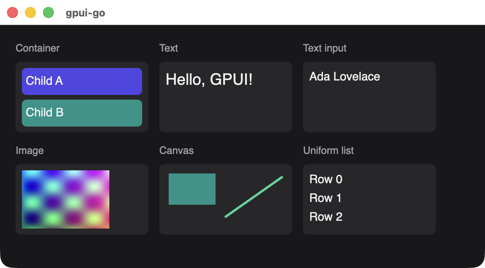

# Element reference

Every view is a tree of six native element kinds. The same elements are reachable from three APIs, at different levels of coverage.

{width=621}

| Element | [`scene`](./div) snapshot API | [`ui`](./reactive-nodes) reactive API | [GoX](./gox-tags) tag |
| --- | --- | --- | --- |
| [Container](./div) | `scene.Div` | `Document.Div` | `div`, `span`, `text`, `button` |
| [Text](./text) | `scene.Text` | `Document.Text`, `Document.BindText` | Literal text, `nativegox.Text` |
| [Text input](./text-input) | `scene.TextInput` | `Document.Input` | `input` |
| [Image](./image) | `scene.Image` | Not available | Not available |
| [Canvas](./canvas) | `scene.Canvas` | Not available | Not available |
| [Uniform list](./uniform-list) | `scene.UniformList` | Not available | Not available |

With the optional [Zed editor](/guide/editor#placing-an-editor-inside-a-view), `scene.Embedded` places a live editor in the tree.

Beyond the elements themselves, see [Node methods](./node-methods) for what applies to every element, [Style properties](./style) for each style field and [Events](./events) for what handlers receive.

## Features by area

| Area | API and behavior |
| --- | --- |
| [Resources](./image#uploading-a-resource) | `UploadResource`, `Image`, `Resource.Release`: PNG, JPEG, GIF and WebP images, SVG icons and fonts |
| [Drawing](./canvas) | `Canvas`: rectangles and filled or stroked paths, including quadratic and cubic curves |
| [Lists](./uniform-list) | `UniformList`, `Window.ScrollTo`: native scroll state, with layout and paint of visible rows only |
| [Keyboard](./node-methods#bindkey) | `Focusable`, `BindKey`, `BindKeyWithContext`, `OnAction`, `Window.DispatchAction`: key contexts, predicates and multi-stroke chords |
| [Input events](./events) | `Interact`, `OnEvent`: keys, mouse, scrolling, focus changes, external file drops and [in-process drag-and-drop](./node-methods#drag-and-drop) |
| [Accessibility](./node-methods#accessible) | `Accessible`: roles, labels, descriptions, selection, expanded and checked state, and values |
| [Style](./style) | Flex, grid and hidden display, wrapping, opacity, font families, alignment, italics and shadows. [`Animate`](./node-methods#animate) covers opacity |
| Models | `CreateModel`, `Read`, revision-checked `Update`, `Observe`, `Release`: Rust-owned entities holding opaque bytes |
| Platform | Window title, size and state; clipboard text; opening URLs; native menus; asynchronous open and save dialogs |

A model change does not rebuild a view by itself: your callback decides whether to call `Window.Set`. Path dialogs return paths without reading or writing files.

## Rules for every snapshot

The Rust side validates each snapshot before changing anything on screen. If validation fails, the call that installed it returns an error and the previous view stays in place.

| Rule | Limit |
| --- | --- |
| Element ID | Nonzero, and unique within the view |
| Elements per view | 10,000, counting list rows and their descendants |
| Tree depth | 32 |
| Encoded message size | 4 MiB |
| Click handler ID | Nonzero |
| Unknown or unspecified enum value | Rejected, so leave a field unset rather than passing an `Unspecified` constant |

## Element IDs

In the `scene` API you choose the IDs. Keep each one stable for as long as it names the same control: the ID is what ties a snapshot's element to native state such as focus, hover, text selection and scroll position. Reusing an ID for a different control carries that state over, and changing an ID loses it.

The `ui` API and GoX allocate IDs for you, and each node keeps its ID for its lifetime.

## Builders

`scene` functions return a `*scene.Node`, and its methods return the same node so calls can chain. Builders are mutable and belong to one goroutine. Passing a child to `scene.Div` copies it, so changing the child afterward has no effect on the parent.

Passing a nil child, or a nil image resource, panics.
