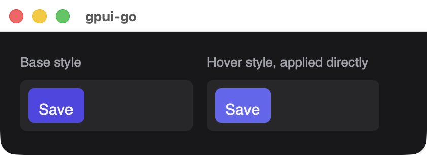
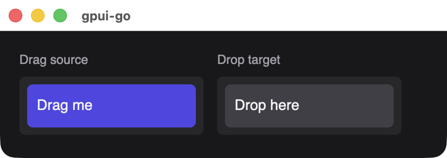

# Node methods

These `*scene.Node` methods work on every element kind and return the node for chaining. For the reactive equivalents, see [Reactive nodes](./reactive-nodes#node-methods).

| Method | Purpose |
| --- | --- |
| [`Style`](#style) | Sets the element's style |
| [`Hover`](#hover) | Sets style changes applied while hovered |
| [`When`](./window-state#conditional-styles) | Sets style changes applied at some window widths or color schemes |
| [`OnClick`](#onclick) | Attaches a click handler |
| [`StopPropagation`](#stoppropagation) | Stops a click from reaching ancestors |
| [`Focusable`](#focusable) | Makes the element focusable |
| [`Interact`](#interact) | Configures keyboard, pointer, focus and drag-and-drop events |
| [`BindKey`](#bindkey), [`BindKeyWithContext`](#bindkeywithcontext) | Attaches a keyboard shortcut |
| [`OnAction`](#onaction) | Binds a logical action |
| [`Accessible`](#accessible) | Sets accessibility metadata |
| [`Animate`](#animate) | Runs an opacity animation |
| `Proto` | Returns an independent copy of the underlying protobuf element |

## Style

```text
func (n *Node) Style(style *Style) *Node
```

Replaces the element's whole style, so a second call does not merge with the first. Nil clears it. See [Style properties](./style).

## Hover

```text
func (n *Node) Hover(style *Style) *Node
```

A partial style layered over the base style while the pointer is over the element. Set only the fields that change. GPUI applies it natively, with no Go event or new snapshot. Nil clears it.

{width=421}

*The hover color is applied as a base style here, to show what `Hover` produces.*

## OnClick

```text
func (n *Node) OnClick(handlerID uint64) *Node
```

Attaches a handler registered with `app.OnClick`. The event's `GetClick()` carries the details, and a click captured from an obsolete view revision is discarded. See [Events](./events).

```go
save := app.OnClick(func(ctx context.Context, event *client.Event) error {
	return nil
})
defer app.RemoveHandler(save)

node := scene.Div(1, scene.Text(2, "Save")).OnClick(save)
```

## StopPropagation

```text
func (n *Node) StopPropagation() *Node
```

Prevents ancestors from receiving the click. Rust applies this synchronously, so a Go handler cannot decide it later. Call it after `OnClick`, because calling it first panics.

## Focusable

```text
func (n *Node) Focusable(tabIndex int32) *Node
```

Makes the element focusable, from a click or Tab navigation. `tabIndex` is from -1 to 32767, and -1 keeps the element focusable but out of the Tab order. Move focus from Go with `Window.Focus(ctx, element)`.

Text inputs are always focusable.

## Interact

```text
func (n *Node) Interact(options *Interaction) *Node
```

Declares which events the element reports. Each field below takes a handler ID from `app.OnEvent`, and zero means off.

| Field | Reports | Requires focus |
| --- | --- | --- |
| `KeyDown`, `KeyUp` | Key presses and releases | Yes |
| `FocusChanged` | Gaining or losing focus | Yes |
| `MouseDown`, `MouseUp` | Left, right and middle buttons | No |
| `MouseMove` | Pointer movement | No |
| `Scroll` | Wheel and trackpad scrolling | No |
| `FileDrop` | Files dropped from the operating system | No |
| `DataDrop` | An in-process [drag](#drag-and-drop) dropped here | No |

The other fields configure behavior:

| Field | Type | Description |
| --- | --- | --- |
| `Focusable` | `bool` | Required when the element uses `KeyDown`, `KeyUp`, `FocusChanged` or key bindings, except on a text input |
| `TabIndex` | `int32` | -1 to 32767, as for `Focusable` |
| `KeyContext` | `string` | Context name for [key binding predicates](#bindkeywithcontext), at most 256 bytes |
| `StopPropagation` | `bool` | Stops every reported interaction event at this element |
| `Drag` | `*scene.DragData` | Makes the element a [drag source](#drag-and-drop) |
| `AcceptDropKind` | `string` | Only accepts in-process drops of this kind. Empty accepts any |

::: warning Call Interact first
`Interact` replaces the element's whole interaction configuration, including what `Focusable` and `BindKey` set. Call it before those methods, or set the same options in the `Interaction` value.
:::

```go
pressed := app.OnEvent(func(ctx context.Context, event *client.Event) error {
	if key := event.GetKeyDown(); key != nil {
		fmt.Println("key:", key.Key)
	}
	return nil
})

node := scene.Div(1).
	Interact(&scene.Interaction{KeyDown: pressed}).
	Focusable(0)
```

`MouseMove` can report at a high rate. The unacknowledged event queue holds 1024 events, and overflowing it is a protocol error, so make sure event dispatch keeps up.

### Drag and drop

```go
dropped := app.OnEvent(func(ctx context.Context, event *client.Event) error {
	if drop := event.GetDataDrop(); drop != nil {
		fmt.Printf("%s: %s\n", drop.Kind, drop.Payload)
	}
	return nil
})

source := scene.Div(1, scene.Text(2, "Drag me")).Interact(&scene.Interaction{
	Drag: &scene.DragData{Kind: "task", Payload: []byte("42"), Preview: "Task 42"},
})
target := scene.Div(3, scene.Text(4, "Drop here")).Interact(&scene.Interaction{
	DataDrop:       dropped,
	AcceptDropKind: "task",
})
```

{width=461}

`scene.DragData` has a required `Kind` of at most 256 bytes, a `Payload` of at most 64 KiB and a `Preview` of at most 4096 bytes, which is the text shown while dragging.

## BindKey

```text
func (n *Node) BindKey(keystroke string, action *Action, handlerID uint64) *Node
```

Attaches a shortcut that is active while focus is on this element or inside it. Join modifiers with hyphens, such as `cmd-k`, and separate the strokes of a chord with a space, such as `cmd-k cmd-s`. The element becomes focusable automatically, and the shortcut does not propagate further once it matches.

```go
increment := app.OnEvent(func(ctx context.Context, event *client.Event) error {
	fmt.Println("action:", event.GetAction().Name)
	return nil
})

node := scene.Div(1, scene.Text(2, "Press Cmd+K")).
	Focusable(0).
	BindKey("cmd-k", &scene.Action{Name: "increment"}, increment)
```

`scene.Action` has a `Name` from 1 to 256 bytes and an optional `Payload` of at most 64 KiB. Rules per element: at most 128 bindings, each keystroke and context pair is unique, and one action name always uses one handler. Keystrokes are at most 128 bytes, and an action must not be nil, which panics.

## BindKeyWithContext

```text
func (n *Node) BindKeyWithContext(keystroke, predicate string, action *Action, handlerID uint64) *Node
```

Like `BindKey`, with a GPUI keymap predicate of at most 1024 bytes, evaluated against the `KeyContext` values along the focus path.

```go
node := scene.Div(1).
	Interact(&scene.Interaction{KeyContext: "Workbench"}).
	BindKeyWithContext("cmd-k cmd-s", "Workbench", &scene.Action{Name: "save"}, handler)
```

## OnAction

```text
func (n *Node) OnAction(name string, handlerID uint64) *Node
```

Binds a logical action with no keystroke, for native menu items and for `Window.DispatchAction(ctx, element, name, payload)`.

## Accessible

```text
func (n *Node) Accessible(label string, metadata *Accessibility) *Node
```

Sets the accessible name, at most 4096 bytes, and optional metadata. Nil metadata clears it and keeps the label. Screen-reader output has not been validated yet.

`scene.Accessibility`:

| Field | Type | Description |
| --- | --- | --- |
| `Role` | `scene.AccessibleRole` | Required, and must not be `RoleUnspecified` |
| `Description` | `string` | Longer description, at most 4096 bytes |
| `Selected` | `*bool` | Selection state |
| `Expanded` | `*bool` | Expanded state |
| `Checked` | `*bool` | Checked state |
| `Value` | `*string` | Current value as text, at most 4096 bytes |

Roles are `RoleGeneric`, `RoleButton`, `RoleCheckbox`, `RoleTextInput`, `RoleText`, `RoleList`, `RoleListItem`, `RoleLink`, `RoleImage`, `RoleSlider` and `RoleDialog`.

```go
node := scene.Div(1, scene.Text(2, "Notifications")).
	Accessible("Notifications", &scene.Accessibility{
		Role:    scene.RoleCheckbox,
		Checked: scene.Ptr(true),
	})
```

{width=461}

*Roles and state are metadata. The visible checkbox marks are ordinary text in this sample.*

## Animate

```text
func (n *Node) Animate(animation *OpacityAnimation) *Node
```

Runs a native opacity animation, the only animated property at present. Nil clears it.

| Field | Type | Description |
| --- | --- | --- |
| `DurationMs` | `uint32` | From 1 to 600,000 |
| `From`, `To` | `float32` | Opacity from 0 to 1 |
| `Repeat` | `bool` | Loops the animation |
| `Generation` | `uint64` | Change this value to restart the animation |

```go
node := scene.Div(1, scene.Text(2, "Saved")).Animate(&scene.OpacityAnimation{
	DurationMs: 300,
	From:       0,
	To:         1,
})
```
