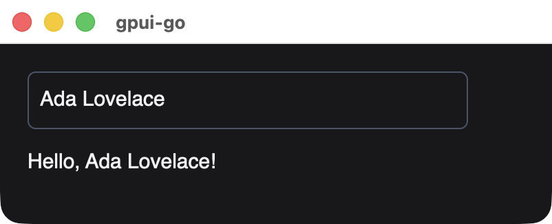
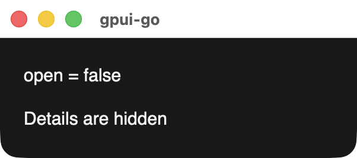
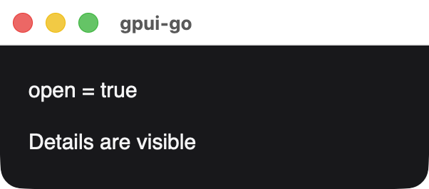
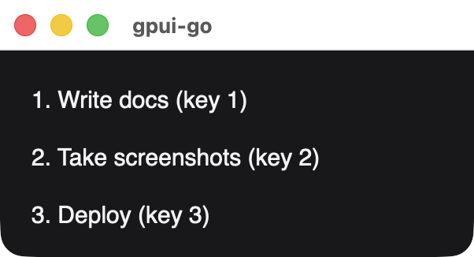
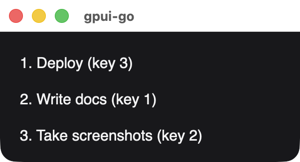

# Reactive nodes

`ui.Document` builds persistent nodes bound to [signals](/guide/reactive). Each constructor takes an owner scope, which controls cleanup. Use `document.Scope()` for ordinary construction, and the scope a factory receives inside `Show` and `For`.

Fluent methods record errors rather than returning them. Check `document.Err()`, which also prevents mounting while an error is present.

## Div

```text
func (d *Document) Div(owner *reactive.Scope, children ...*Node) *Node
```

The persistent form of a [container](./div). Change its children with these methods. Each validates ownership, cycles, duplicates and existing parents before changing anything:

| Method | Description |
| --- | --- |
| `SetChildren(children...) error` | Replaces the children. Omitted children are disposed |
| `Append(children...) error` | Adds children to the end |

After mounting, group direct node changes in `graph.Batch`, or call `graph.Flush` afterward. Signal updates and event handlers already provide that boundary.

## Text

```text
func (d *Document) Text(owner *reactive.Scope, value string) *Node
func (d *Document) BindText(owner *reactive.Scope, read func() string) *Node
```

`Text` displays a fixed string. `BindText` re-evaluates `read` when a signal it reads changes, and updates only that node.

```go
label := document.BindText(owner, func() string {
	return fmt.Sprintf("Count: %d", count.Get())
})
```

## Input

```text
func (d *Document) Input(owner *reactive.Scope, value *reactive.Signal[string], options InputOptions) *Node
```

A [text input](./text-input) bound to a string signal, in both directions. Native edits update the signal. Setting the signal from Go replaces the field's text, without recreating the native editor.

`ui.InputOptions`:

| Field | Type | Description |
| --- | --- | --- |
| `Placeholder` | `string` | Shown while empty |
| `Disabled` | `func() bool` | Optional. May read signals, and is re-evaluated when they change |
| `Masked` | `func() bool` | Optional. May read signals, so a show/hide toggle can change it. See [masked input](./text-input#masked-input) |

```go
name := reactive.NewSignal(owner, "Ada")
field := document.Input(owner, name, ui.InputOptions{Placeholder: "Your name"})
```

{width=401}

*A signal bound to the field and to a `BindText` preview, after setting the signal from Go.*

## Fragment

```text
func (d *Document) Fragment(owner *reactive.Scope, children ...*Node) *Node
```

Groups children without adding a native element or affecting layout. A fragment only manages children, so do not call `Style`, `Accessible`, `Focusable` or `OnClick` on it.

## Show

```text
func (d *Document) Show(owner *reactive.Scope, condition func() bool, yes, no func(*reactive.Scope) *Node) *Node
```

Renders one branch, and swaps it when `condition` changes. The previous branch's scope, nodes and handlers are disposed. Either factory can be nil to render nothing. Factories run untracked, so put reactive reads inside bindings created in the supplied scope.

```go
details := document.Show(owner, open.Get,
	func(scope *reactive.Scope) *ui.Node { return document.Text(scope, "Details") },
	nil,
)
```

{width=301}

{width=301}

## For

```text
func For[T any, K comparable](d *Document, owner *reactive.Scope, items func() []T, key func(T) K, render func(*reactive.Scope, *reactive.Signal[T], *reactive.Signal[int]) *Node) *Node
```

Renders one row per item, retained by key. The render function runs once per inserted key and receives a row scope, an item signal and an index signal. Reordering keeps native focus and selection, and removing a key disposes its row. Duplicate keys fail before any change is published, and each key must stay stable for an item's lifetime.

```go
type Task struct {
	ID    int
	Title string
}

rows := ui.For(document, owner, tasks.Get,
	func(task Task) int { return task.ID },
	func(scope *reactive.Scope, task *reactive.Signal[Task], index *reactive.Signal[int]) *ui.Node {
		return document.BindText(scope, func() string {
			return fmt.Sprintf("%d. %s", index.Get()+1, task.Get().Title)
		})
	},
)
```

{width=301}

{width=301}

*The same list after setting a reordered slice. Each row keeps its key and receives a new index.*

## Node methods

| Method | Description |
| --- | --- |
| `Style(style)` | Sets the style |
| `BindStyle(read)` | Sets the style from a function that may read signals |
| `Accessible(label, metadata)` | Sets accessibility metadata |
| `BindAccessibility(label, read)` | Sets accessibility metadata from a function that may read signals |
| `Focusable(index)` | Makes the node focusable |
| `OnClick(handler)` | Attaches a `ui.Handler`, which is batched automatically and removed with the node |
| `Name(name)` | Registers a name for `Document.Element` and UI tests. Must be nonempty and unique |
| `ID()` | Returns the stable element ID |
| `Scope()` | Returns the node's owner scope |
| `Dispose()` | Disposes the node, its descendants, computations and handlers |

`Hover`, `Interact`, `BindKey`, `Animate`, images, canvases and uniform lists are not available on `ui` nodes. Use the [`scene` API](./) when you need them.

## Mounting

```text
func (d *Document) OpenWindow(ctx context.Context, options client.WindowOptions, root *Node) (*Mount, error)
```

Opens one native window for `root`. Close the returned `Mount` before shutting down the client, because disposing a graph or document does not close native windows. `Mount.Window` exposes the underlying window.
