# Style properties

A `scene.Style` describes one element. Every field is optional, and an absent field uses GPUI's default. Because each snapshot is complete, a property you leave out of the next snapshot returns to its default.

```go
style := &scene.Style{
	Width:          scene.Percent(100),
	Padding:        scene.Padding(16),
	Gap:            scene.Pixels(8),
	FlexDirection:  scene.FlexRow.Enum(),
	AlignItems:     scene.AlignCenter.Enum(),
	JustifyContent: scene.JustifySpaceBetween.Enum(),
	Background:     scene.RGB(0x0f172a),
	FontSize:       scene.Ptr[float32](15),
}
```

## Value helpers

| Helper | Produces |
| --- | --- |
| `scene.Pixels(v)` | A length in logical pixels |
| `scene.Percent(v)` | A percentage from 0 to 100 |
| `scene.Rems(v)` | A length relative to the root font size |
| `scene.Auto()` | An automatic length |
| `scene.Padding(v)` | The same pixel length on all four edges |
| `scene.RGB(0xRRGGBB)` | An opaque color |
| `scene.Ptr[T](v)` | An optional scalar. An explicit zero or false stays present |
| `.Enum()` | An optional enum field, as in `scene.FlexColumn.Enum()` |

For a translucent color, build the value directly, with each channel from 0 to 1:

```go
overlay := &scene.Color{Red: 0, Green: 0, Blue: 0, Alpha: 0.5}
```

For different edges, build a `scene.Edges`. Omitted edges stay unset:

```go
edges := &scene.Edges{Top: scene.Pixels(8), Left: scene.Rems(1)}
```

Pixel and rem lengths must be finite, with a magnitude of at most 1,000,000.

## Size

| Field | Type | Accepts |
| --- | --- | --- |
| `Width`, `Height` | `*scene.Length` | Pixels, percent, rems, auto. Not negative |
| `MinWidth`, `MinHeight` | `*scene.Length` | Same |
| `MaxWidth`, `MaxHeight` | `*scene.Length` | Same |

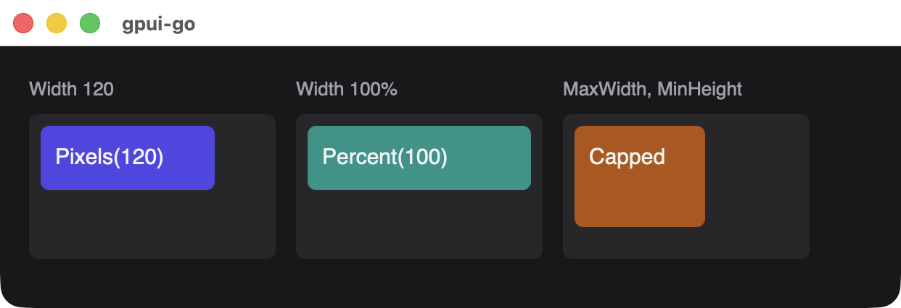{width=621}

## Spacing

| Field | Type | Accepts |
| --- | --- | --- |
| `Padding` | `*scene.Edges` | Pixels, percent, rems. Not auto or negative |
| `Margin` | `*scene.Edges` | Pixels, percent, rems, including negative. Not auto |
| `Gap` | `*scene.Length` | Pixels or rems only, not negative. Applies to rows and columns |

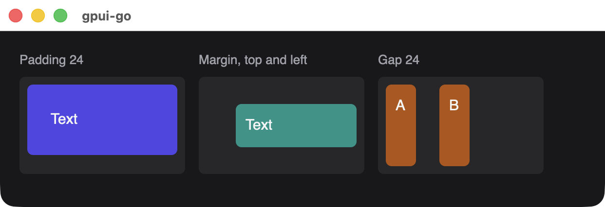{width=621}

## Layout

| Field | Type | Values |
| --- | --- | --- |
| `Display` | `*scene.Display` | `DisplayFlex`, `DisplayGrid`, `DisplayNone` |
| `FlexDirection` | `*scene.FlexDirection` | `FlexRow`, `FlexColumn` |
| `FlexWrap` | `*bool` | True wraps children onto new lines |
| `FlexGrow`, `FlexShrink` | `*float32` | 0 or greater |
| `AlignItems` | `*scene.Alignment` | `AlignStart`, `AlignCenter`, `AlignEnd`, `AlignStretch` |
| `JustifyContent` | `*scene.Justification` | `JustifyStart`, `JustifyCenter`, `JustifyEnd`, `JustifySpaceBetween` |
| `GridColumns` | `*uint32` | 1 to 1024 equal columns |

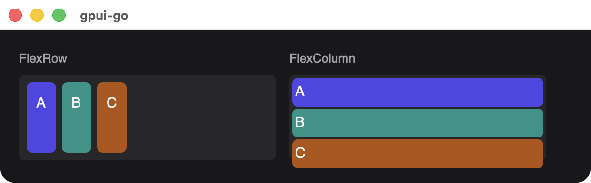{width=621}

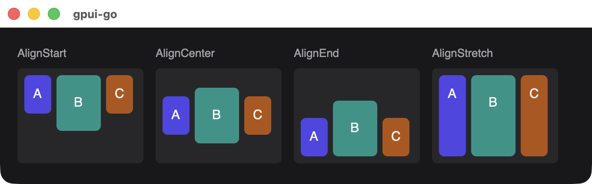{width=681}

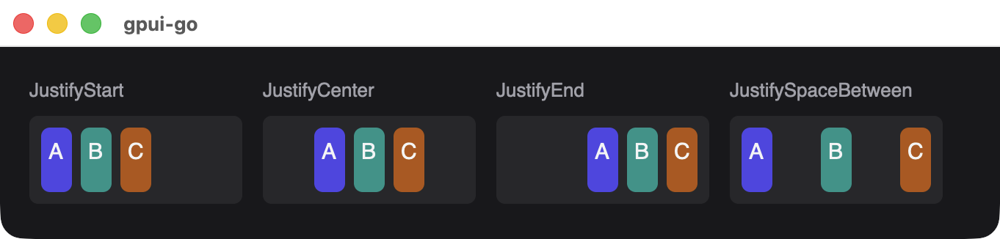{width=681}

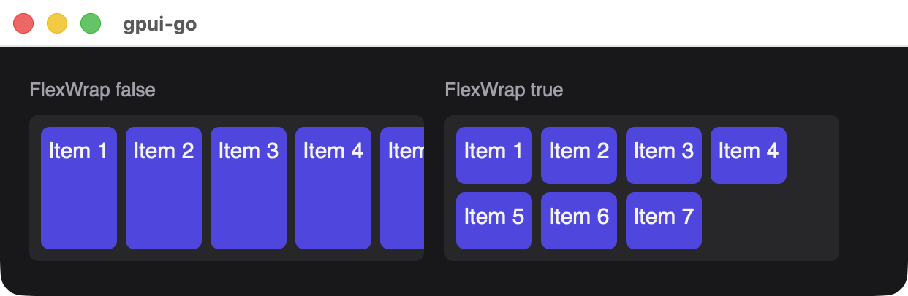{width=621}

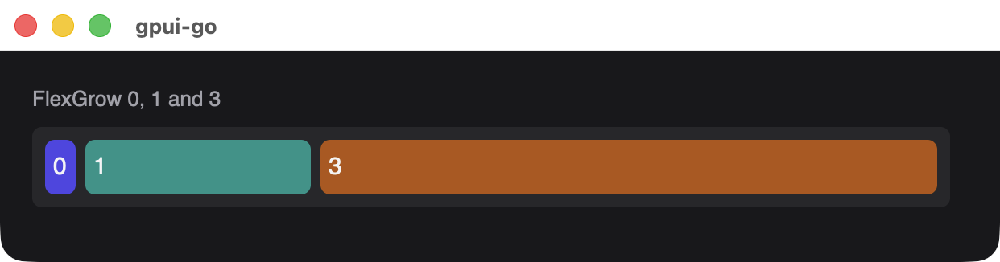{width=621}

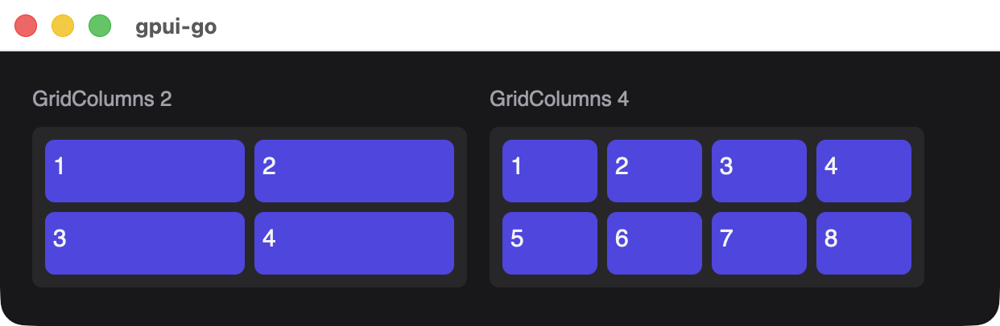{width=621}

::: warning FlexDirection overrides Display
Setting `FlexDirection` forces flex display, even when the same style sets `Display` to `DisplayGrid` or `DisplayNone`. To hide or grid a container, leave `FlexDirection` unset in that style.
:::

## Positioning

| Field | Type | Values |
| --- | --- | --- |
| `Position` | `*scene.Position` | `PositionRelative`, `PositionAbsolute` |
| `Inset` | `*scene.Edges` | Offsets from each edge. Pixels, percent, rems or auto, including negative |

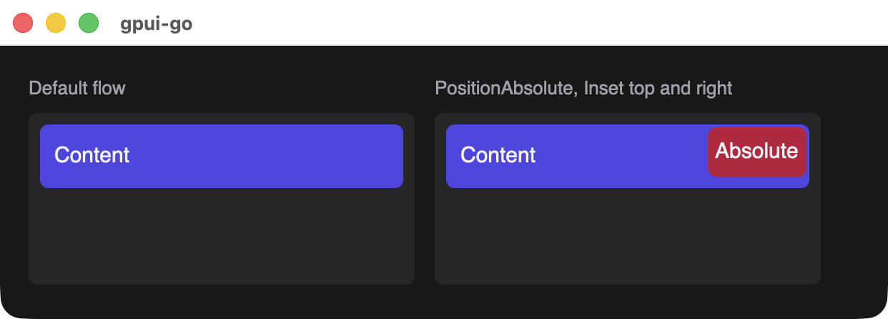{width=621}

## Overflow

| Field | Type | Values |
| --- | --- | --- |
| `OverflowX`, `OverflowY` | `*scene.Overflow` | `OverflowVisible`, `OverflowHidden`, `OverflowScroll` |

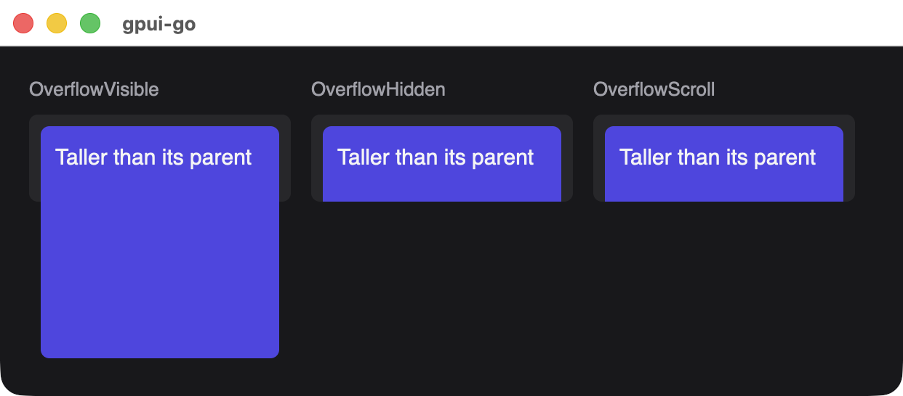{width=621}

## Color and borders

| Field | Type | Values |
| --- | --- | --- |
| `Background` | `*scene.Color` | Background color |
| `Opacity` | `*float32` | 0 to 1 |
| `BorderWidth` | `*float32` | Applied to all four sides, 0 or greater |
| `BorderColor` | `*scene.Color` | Border color |
| `CornerRadius` | `*float32` | Applied to all four corners, 0 or greater |
| `Shadows` | `[]*scene.Shadow` | At most 8 |

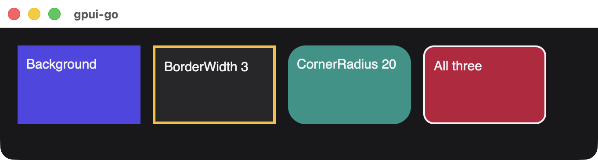{width=681}

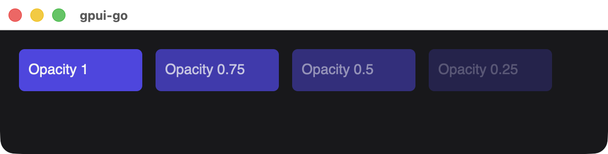{width=641}

`scene.Shadow` has a `Color`, a required `Offset` point, a `Blur` of 0 or greater and a `Spread`. Inset shadows are not available.

```go
style := &scene.Style{
	Shadows: []*scene.Shadow{{
		Color:  &scene.Color{Alpha: 0.3},
		Offset: &scene.Point{Y: 4},
		Blur:   12,
	}},
}
```

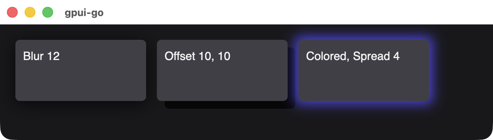{width=641}

## Text

These are inherited by descendants.

| Field | Type | Values |
| --- | --- | --- |
| `TextColor` | `*scene.Color` | Text color |
| `FontSize` | `*float32` | Logical pixels, 0 or greater |
| `FontWeight` | `*uint32` | 100 to 900 |
| `FontFamily` | `*string` | Nonempty, at most 256 bytes |
| `Italic` | `*bool` | True for italic |
| `TextAlign` | `*scene.TextAlignment` | `TextAlignLeft`, `TextAlignCenter`, `TextAlignRight` |

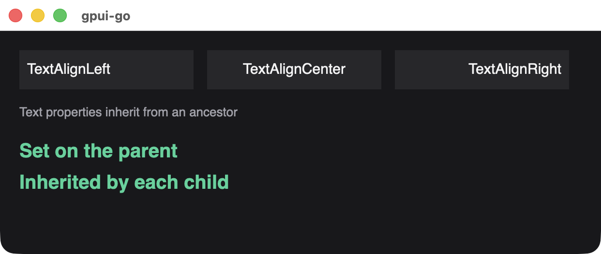{width=621}

## Pointer

| Field | Type | Values |
| --- | --- | --- |
| `Cursor` | `*scene.Cursor` | `CursorArrow`, `CursorPointer` |
