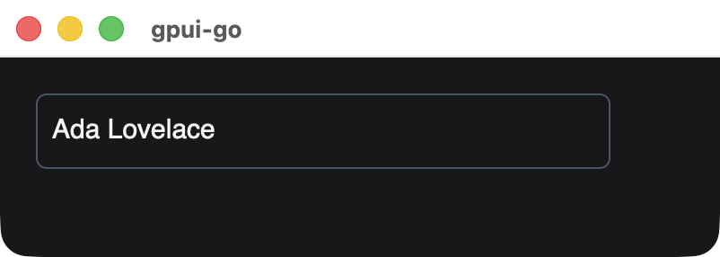
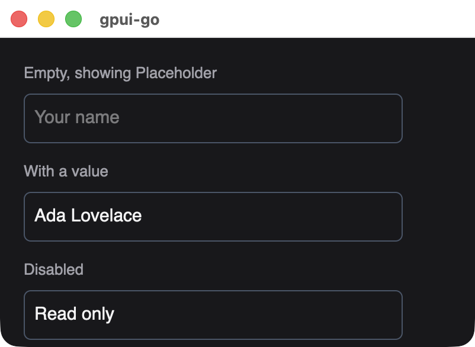
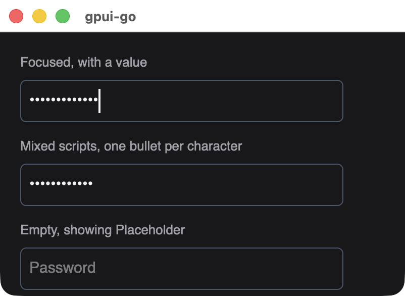
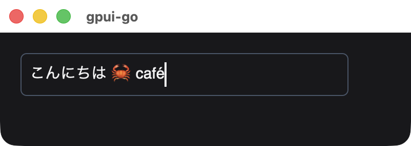

# Text input

A persistent, single-line native text field. It supports mouse and keyboard selection, clipboard shortcuts, Unicode grapheme movement and IME composition. Rust owns the caret, selection and composition, and Go mirrors the value.

```go
name := scene.InputState{Value: "Ada Lovelace"}
onChange := app.OnTextChange(func(ctx context.Context, event *client.Event) error {
	if name.Accept(event.GetTextChanged()) {
		return window.Set(ctx, render())
	}
	return nil
})

// Inside render():
field := scene.TextInput(10, name, scene.TextInputOptions{
	Placeholder: "Your name",
	OnChange:    onChange,
}).Style(&scene.Style{
	Width:        scene.Pixels(320),
	Padding:      scene.Padding(8),
	BorderWidth:  scene.Ptr[float32](1),
	BorderColor:  scene.RGB(0x475569),
	CornerRadius: scene.Ptr[float32](6),
})
```

{width=401}

## Signature

```text
func TextInput(id uint64, value InputState, options TextInputOptions) *Node
```

`scene.TextInputOptions`:

| Field | Type | Description |
| --- | --- | --- |
| `Placeholder` | `string` | Shown while the field is empty. At most 4096 bytes, and a single line |
| `OnChange` | `uint64` | Handler from `app.OnTextChange`. Zero means no change events |
| `Disabled` | `bool` | Blocks editing, mouse focus and tabbing into the field. It does not change the field's appearance, so style a disabled field yourself |
| `Masked` | `bool` | Draws one bullet per character instead of the text, for passwords. See [masked input](#masked-input) |

{width=401}

## Masked input

Set `Masked` for passwords and other sensitive text. The field draws one bullet for each user-perceived character. Caret movement, selection and clicks work as usual.

{width=401}

While masked:

- Copy and cut do nothing. Paste still works.
- Text services cannot read the field's contents, and screen readers get the password role with bullets as the value.
- `Value` and change events still hold the real text, so your handler can use it. Avoid logging it.

Masking only hides the text on screen and from those channels. The plaintext is still in application memory. An input method's own candidate window can show composing text, and other applications are not prevented from observing keystrokes, because the OS secure keyboard entry mode is not used.

Changing `Masked` on the same element ID keeps the text, focus and selection, which is how to build a show/hide toggle.

## InputState

`scene.InputState` keeps Go's copy of the field in step with native edits. Its zero value is an empty field.

| Member | Description |
| --- | --- |
| `Value` | The current text |
| `Epoch` | Counts replacements decided by Go |
| `EditRevision` | The latest native edit Go has acknowledged |
| `Accept(change) bool` | Applies a native edit. Returns false for a stale change, when the view does not need updating |
| `Reset(value)` | Replaces the text from Go, for example to clear a form, and starts a new epoch |

Change `Value` only through `Accept` and `Reset`. Assigning to it directly leaves the epoch unchanged, so the native field keeps its current text.

Because of this protocol, an older snapshot cannot overwrite focus, selection, composition or newer typing, so input is not lost to a slow round trip. Edits queued before a `Reset` are ignored.

## Change events

The handler receives an event whose `GetTextChanged()` returns:

| Field | Description |
| --- | --- |
| `Value` | The complete new text |
| `Epoch`, `EditRevision` | Used by `Accept` |
| `Composing` | True while an IME composition is in progress |

Events also fire during composition, so a live preview updates as the user types.

## Keyboard and mouse

| Input | Behavior |
| --- | --- |
| Click and drag | Places the caret and selects |
| Arrow keys, Shift+arrow | Moves the caret, extends the selection, by grapheme |
| Home, End | Moves to the start or end |
| Backspace, Delete | Removes text |
| Cmd/Ctrl+A, C, X, V | Select all, copy, cut, paste |
| Tab, Shift+Tab | Moves focus |

{width=401}

*A focused field with mixed scripts. Focus was set from Go with `Window.Focus`.*

## Limits and rules

- The value is limited to 64 KiB of UTF-8.
- Typed or pasted line breaks become spaces. A snapshot whose `Value` or `Placeholder` contains a line break is rejected, so normalize text you set from Go.
- Keep the same element ID to retain focus and selection.
- Undo/redo and multiline editing are not implemented. For multiline text, see the [Zed editor](/guide/editor).

## Styling

The style applies to the element around the field. The editable line inside is 24 pixels tall and fills the available width, so `Width` and `Padding` control the visible field size. Text properties such as `TextColor` and `FontSize` apply as they do for [text](./text).

## Available in other APIs

- `ui`: [`Document.Input`](./reactive-nodes#input) binds the field to a string signal and handles `InputState` for you.
- GoX: the [`input` tag](./gox-tags#input).
