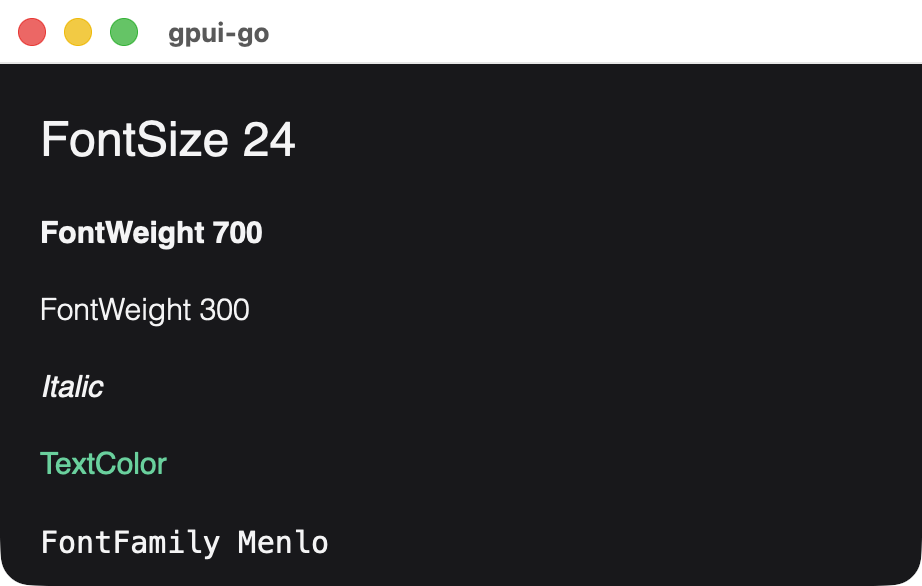

# Text

A text element displays one string in a single style.

```go
title := scene.Text(1, "Welcome back").Style(&scene.Style{
	FontSize:   scene.Ptr[float32](24),
	FontWeight: scene.Ptr[uint32](600),
	TextColor:  scene.RGB(0xf4f4f5),
})
```

{width=341}

## Signature

```text
func Text(id uint64, text string) *Node
```

| Parameter | Description |
| --- | --- |
| `id` | Stable nonzero element ID |
| `text` | The string to display. It is shown literally, with no markup or escaping |

## Styling

These properties apply to the text and are inherited by descendants, so you can set them once on an ancestor:

| Property | Notes |
| --- | --- |
| `TextColor` | Text color |
| `FontSize` | Logical pixels |
| `FontWeight` | 100 to 900 |
| `FontFamily` | A system font, or one [uploaded as a resource](./image#uploading-a-resource) |
| `Italic` | Italic style |
| `TextAlign` | Left, center or right |

{width=461}

The root element of every view starts with the Helvetica font family until a style sets another.

Mixed styles within one string are not supported. To combine styles on one line, put several text elements in a row container.

{width=461}

*Four text elements in a row container.*

Text cannot have children. It accepts the [common node methods](./node-methods), including `OnClick` and `Hover`.

## Available in other APIs

- `ui`: [`Document.Text` for static text and `Document.BindText` for reactive text](./reactive-nodes#text).
- GoX: [literal text and `nativegox.Text`](./gox-tags#text-content).
