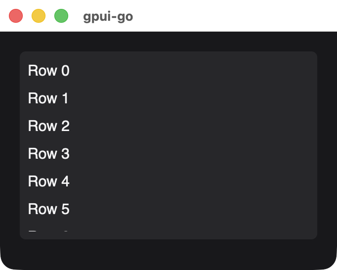
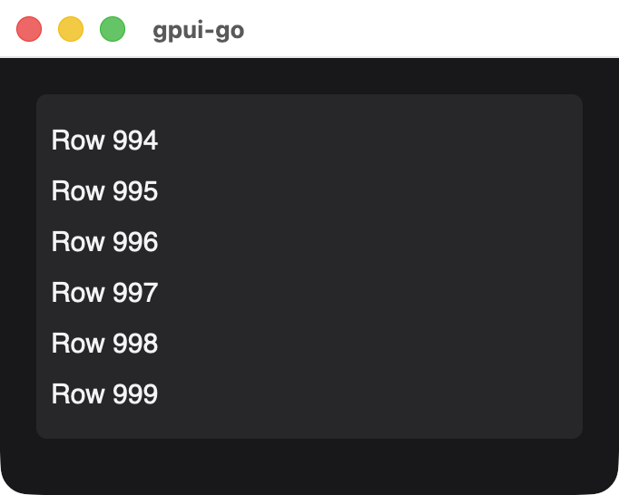

# Uniform list

A scrolling list whose rows all have the same height. Only visible rows are laid out and painted.

```go
rows := make([]*scene.Node, 0, 1000)
for i := range 1000 {
	// Each row needs its own ID, and so does every element inside it.
	rows = append(rows, scene.Text(uint64(100+i), fmt.Sprintf("Row %d", i)))
}

list := scene.UniformList(50, 28, rows...).Style(&scene.Style{
	Width:  scene.Percent(100),
	Height: scene.Pixels(320),
})
```

{width=341}

## Signature

```text
func UniformList(id uint64, rowHeight float32, rows ...*Node) *Node
```

| Parameter | Description |
| --- | --- |
| `id` | Stable nonzero element ID, also the target for `ScrollTo` |
| `rowHeight` | Height of every row in logical pixels, from 1 to 16384 |
| `rows` | Row nodes, each copied. A nil row panics |

The list fills its box, so give it a definite height. Each row is as wide as the list and exactly `rowHeight` tall, and content past that height is clipped.

## Scrolling from Go

```go
if err := window.ScrollTo(ctx, 50, 999); err != nil {
	return err
}
```

{width=341}

*The same list after `ScrollTo(ctx, 50, 999)`.*

`Window.ScrollTo(ctx, element, item)` scrolls so that the zero-based row is visible. It returns an error if the element is not a uniform list or the row is out of range. Scroll position is native state that persists across snapshots.

## Limits

Virtualization covers layout and painting, not data transfer. Go sends every row in every snapshot, and rows and their contents count toward the [10,000-element and 4 MiB limits](./#rules-for-every-snapshot). Paged and variable-height lists are not available.

## Available in other APIs

In a [`ui` application](./reactive-nodes#uniformlist), use `Document.UniformList` with [`ui.For`](./reactive-nodes#for) rows, which keep their element IDs when reordered. In a GoX template, use the [`uniform-list` tag](./gox-tags#image-canvas-and-uniform-list).
